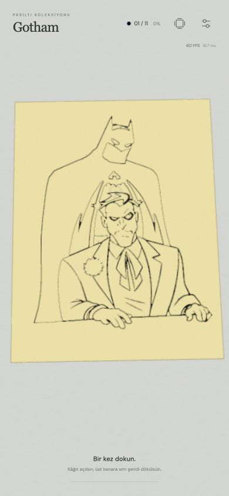
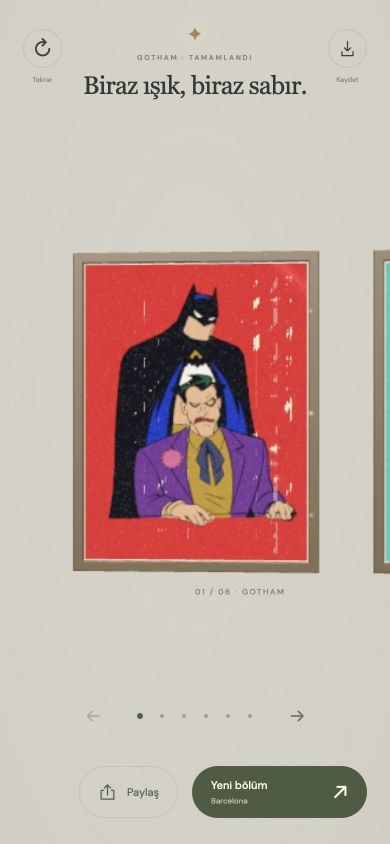
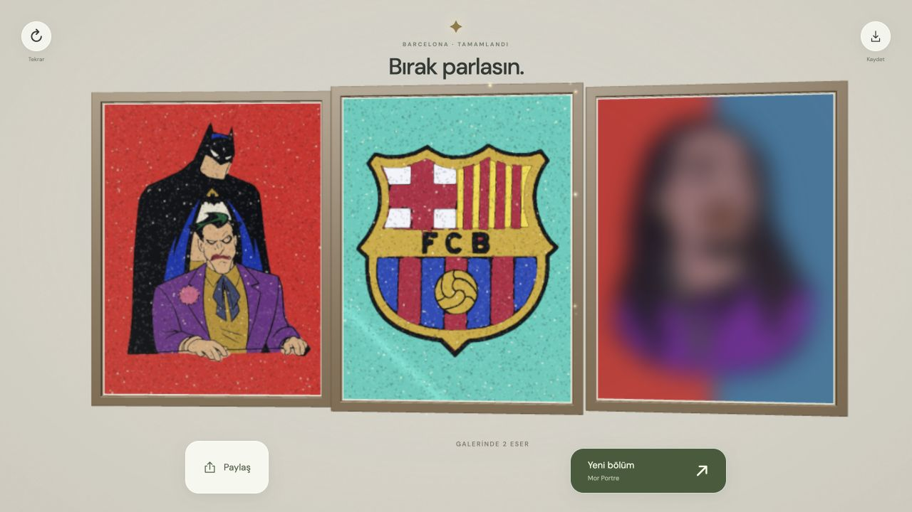
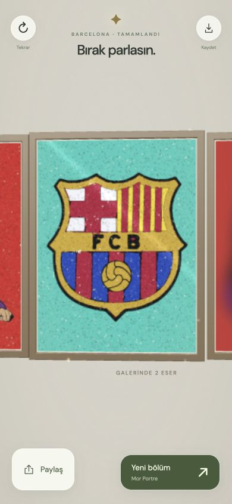
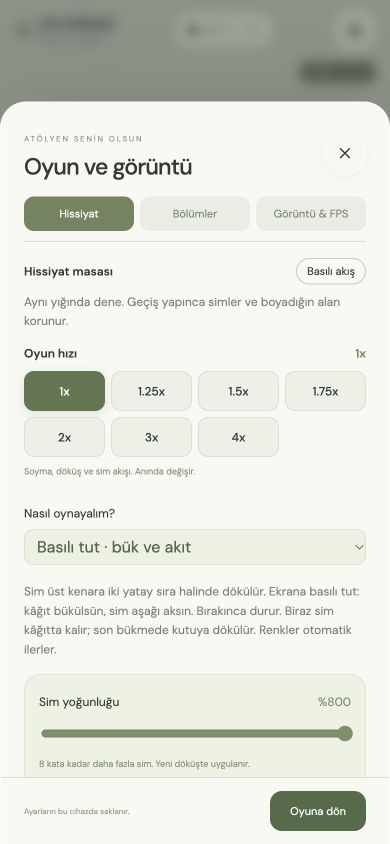

# Sim Atölyesi — Claude devir belgesi

Tarih: 5 Kasım 2026. Ürün/cache sürümü **v20**. Bu belge mevcut oyunu devralmak içindir; yeni bir oyun tasarlama talebi değildir.

## 1. Repo, kayıt noktası ve yayın

- Repo: https://github.com/Furkiti/sim-atolyesi
- Dal: `main`
- Canlı oyun: https://furkiti.github.io/sim-atolyesi/?v=20&mod=basili
- Bu makinedeki Git kökü: `/Users/furkanbedir/Documents/ChatGPT/batman/github-pages`
- Üstteki `batman` klasörü Git kökü değildir. Claude’u doğrudan `github-pages` klasöründe aç.
- Güncel geliştirme: **v20**, sade stüdyo ve kesintisiz sergi. Son SHA için `git log -1` kullan. Önceki runtime `bec29b5` (v19).
- Tarihsel checkpoint: **`v19-handoff`** etiketi; güncel v20 ile karıştırma.
- v20 ürün/teknik kararları: [v20-ui-references.md](v20-ui-references.md). Referans araştırması, üç UI yönü ve ölçüm sınırları burada.

Önemli yakın geçmiş:

| Commit | Değişiklik |
| --- | --- |
| `bec29b5` | 1x–4x oyun hızı, kalıcılık, güvenli fizik alt adımları |
| `34f2ef7` | Çerçeveli galeri, gerçek önceki eser, bulanık sonraki eser |
| `3a20f58` | Şapkalı Portre ve Afro Çocuk bölümleri |
| `da7fc70` | Yeni bitiş sunumu, paylaş/kaydet ve düğme animasyonları |

`package.json` içindeki `1.0.0`, v20 cache sürümünden ayrıdır.

## 2. Ürünün amacı ve kullanıcının öncelikleri

Referans, yapışkan şablonlu bir kâğıda gerçek sim dökülüp yayılan video sanatlarıdır. Kullanıcı için en önemli konu hissiyattır: malzemenin hacmi, gerçek bir kaynaktan dökülmesi, akması, yapışması, fazlanın kâğıt bükülerek kutuya boşalması ve tatmin edici soyma animasyonu.

Geçmişte özellikle düzeltilen ve geri getirilmemesi gereken davranışlar:

- Fırçanın sim olmayan yerleri boya gibi doldurması.
- Parmak kaldırılınca yığının yeniden çoğalması/şişmesi.
- Görünür boşlukları geniş toleransla otomatik boyama.
- Kâğıdın renk geçişinde kaybolması veya çizgiye çökmesi.
- Sim tepelerinin sivri kule/glitch hâline gelmesi.
- Gevşek malzemenin tek katı kalıp gibi hareket etmesi.
- Üst/yan kenardan çıkan simlerin hâlâ kâğıdın ön yüzünden aşağı çizilmesi.
- Bükülen kâğıdın zeminin içine girmesi.
- Ekrandayken düşen parçaların bir anda silinmesi.
- iOS’ta istemsiz zoom, metin seçimi/kopyala menüsü ve ikinci parmağın kontrolü devralması.
- Büyük arayüzün resmi küçültmesi veya bitiş modalının eseri kapatması.

Bunlar tarihsel sorunlardır; hepsi şu anda yeniden üretilmiş açık hata listesi değildir. Kullanıcı Türkçe, kısa iletişim ve doğrudan uygulanmış değişiklik + GitHub Pages linki tercih ediyor.

## 3. Kurulum ve günlük çalışma

Bu makinede son kullanılan ortam: Node **22.23.4**, npm **10.9.9**. Node/npm yeterli; backend, veritabanı, API anahtarı, Godot veya video işleme aracı çalışma zamanı için gerekmiyor.

```sh
git clone https://github.com/Furkiti/sim-atolyesi.git
cd sim-atolyesi
npm ci
npm run build
npm run dev
```

Yerel adres: http://localhost:4173

```sh
npm test
```

Sunucu `scripts/serve.mjs` ile çalışır. Tarayıcı `src/main.js` dosyasını doğrudan çalıştırmaz; **`game.js`** kullanır. Kaynak değişikliğinden sonra yeniden derle ve yenile. Vite/HMR/React yoktur.

Bağımlılıklar: Three.js `^0.187.0`, esbuild `^0.28.2`, pngjs `^7.0.0`; kilit dosyası repodadır. Three.js bundle içine alınır. CSS fontu Google Fonts’tan yüklemeyi dener ve sistem fontu yedeği vardır.

## 4. Açık ve kapalı bölümler

Sıra ve Yeni bölüm döngüsü `src/levels.js` içindeki açık `levels` listesinden gelir:

| Ad | URL kimliği | Renk |
| --- | --- | --- |
| Gotham / Batman & Joker | `gotham` | 11 |
| Barcelona | `barcelona` | 7 |
| Mor Portre | `mor-portre` | 8 |
| Naruto | `naruto` | 8 |
| Şapkalı Portre | `sapkali-portre` | 9 |
| Afro Çocuk | `afro-cocuk` | 8 |

Toplam **51 açık renk aşaması**. Şu dört bölüm kullanıcının isteğiyle kapalıdır: `ay-bahcesi`, `cilekli-kedi`, `boba-molasi`, `kurbaga-pastanesi`. Kaynakları ve asset’leri korunur. `levelCatalog` hepsini içerir; `enabledIds`/`levels` açık olanları süzer. Kapalı/bilinmeyen bölüm URL’si Gotham’a düşer.

URL örnekleri:

- `?v=20&mod=basili&bolum=barcelona`
- `?v=20&mod=egim&bolum=naruto`
- `?v=20&bolum=gotham` — kaydedilmiş moda göre açılır; mod ayarlardan da seçilir.
- `?v=20&mod=basili&bolum=barcelona&devam=7` — önceki renkleri hazır çizip son rengi oynatır.

`devam` **1 tabanlıdır**; sınır dışı değer ilk renge döner. Bu, aşama ilerlemesinin otomatik kaydı değildir; test/yeniden başlama kısayoludur. `v` bir cache kırma parametresidir, ayrı eski oyun sürümlerini yönlendirmez.

## 5. Üç oyun modu

### Basılı tut (`hold`, URL’de `mod=basili`)

Son kullanıcı çalışmalarının ağırlığı bu moddadır. Cımbız şablonu açar, şişe üst kenara bir veya iki yatay sıra sim bırakır. Basılı tutuldukça kâğıt bükülür ve sim aşağı akar; bırakılınca akış durur. Yapışkana ulaşan paketler yaklaşık 0,18 oyun saniyelik oturma hareketinden sonra tutunur.

`HoldCascade` bilinçli olarak **yönlendirilmiş koreografi** kullanır. Her hedef hücreye giden gerçek sonlu bir parçacık rotası vardır; görünmez boya damgası değildir. Kullanıcı bu modda tam serbest fiziğin şart olmadığını özellikle söyledi. Sadece daha fiziksel görünsün diye tüm modu serbest cisim simülasyonuna çevirme.

- Yoğunluk: 0,5–8 kat.
- Tane boyutu: 0,7–4 kat; yoğunluktan bağımsızdır.
- Tek sıra / iki sıra: toplam malzeme seçilen şeritlere bölünür; normal hızda döküş 4 / 6 oyun saniyesidir.
- Fazla gevşek paket miktarı yoğunluğa göre yaklaşık 5.250–84.000’dir; hedef paketleri buna eklenir.
- Her döküşte rastgele yerlerde ufak tozlar kalır. Sabit, büyük birikinti adaları yoktur. İnce artıklar ana tane boyutundan bağımsızdır; son bükmede boşalırlar.
- `Bu rengi yeniden dene`, tamamlanmış önceki renkleri koruyarak mevcut rengi yeni ayarlarla döker.

### Fırça (`brush`)

Fırça yalnızca mevcut simi taşır. Boş fırça boya üretmez. Sadece dökmek alanı otomatik kaplamaz; fırça ile malzemeye temas gerekir. Yassı, yuvarlak ve yelpaze fırça; Doğal/Kadife/Akışkan hissiyatları ve ayrı hareketlilik/tepki ayarları vardır.

### Telefon eğimi (`tilt`, URL’de `mod=egim`)

Telefonun duruşu simi taşır; yapışkana temas eden taneler fırça olmadan tutunur. iOS hareket izni kullanıcı dokunuşu içinde istenir. HTTPS ve destekleyen cihaz gerekir. Düz say kalibrasyonu ve açıkça etiketli sensörsüz ekran denemesi bulunur. Sensörün filtrelenmesi/izin akışı oyun hızıyla çoğaltılmaz.

Modlara ait ayarlar kısmen farklıdır. Basılı tut modunda fırçaya özgü hissiyat seçenekleri gizlenir; tüm ayarların bütün modlarda aynı etkiyi yapmasını varsayma.

## 6. Oyun akışı ve fizik sınırları

`Flow` fazları: `peel → rolling → pour → brush → shake → sonraki renk / complete`.

- Tek dokunuş cımbızla soyma başlatır. Aynı rengin bağlantısız parçaları sırayla açılır.
- Soyarken basılı tutmak soyma saatini ayrıca 4 kat hızlandırır. Genel hızla çarpılır; örneğin 4x + basılı soyma toplam 16x olabilir.
- Açılmadan hemen önce beyaz bir yapışkan parlaması eklenmez. Açılan alan kontrastlı taralı yüzeydir.
- Son rötuş sınırı `min(8 piksel, alanın %0,02’si)`; Titiz modda `min(2 piksel, alanın %0,02’si)`.
- Basılı akışta renk hazır olunca **bırakmak** temizlemeyi/ilerlemeyi tetikler.
- Temizleme iki yandan oluk oluşturup ortadaki simi aşağıdaki kutuya boşaltır. Drenajın bitmesi kontrol edilmeden renk değiştirilmez.
- Temizleme sonrasında kâğıt tam düzleşir; küçük bükülme değerlerinde kararlı geometri önemlidir.

Kâğıt **600×800**, fizik hücresi **5×5** (120×160 hücre). Hücre kapsaması kaynak maskenin gerçek pikselleriyle kesişir. `AIR`, `FREE`, `BOUND`, `LOST` parçacık durumları kullanılır. Başlangıç kapasitesi 48.000; basılı akış kapasitesi en fazla 112.000; çizim havuzları en fazla 128.000. Yığın yüksekliği sınırlandırılmıştır. Kapasite dolunca malzeme klonlanmamalı.

## 7. v19 oyun hızı — kritik zaman ayrımı

Hissiyat sekmesindeki seçenekler: **1x, 1.25x, 1.5x, 1.75x, 2x, 3x, 4x**. Varsayılan 1x, anında uygulanır ve kaydedilir.

`gameSteps(realDelta, speed)` gerçek delta’yı hızla çarpar ve **en fazla 40 ms** adımlara böler. Mevcut uzun kare koruması gerçek delta’yı önce 60 ms ile sınırlar. Hızı çarptıktan sonra delta’yı tekrar 40 ms’ye kırpmak 4x etkisini yok eder; bunu yapma.

- `advanceGame(dt)` faz sayaçları, sim, basılı akış, kâğıt ve düşen malzemenin oyun zamanını ilerletir.
- Fırça izi ve sensör okuma gerçek kare başına bir kez işlenir. Fizik alt adımı başına aynı fırçayı tekrar sürmek malzemenin yanlış çoğalmasına/taşınmasına yol açar.
- FPS sınırı, FPS/CPU ölçümleri ve UI animasyonları gerçek zamandadır. Sahne/bitiş animasyonları oyun zamanındadır.
- `view.updateSpill(dt)` simülasyon tarafındadır. Render’da bir kez daha ilerletme.
- `view.updateCollector(phase, 0)` render’da sadece faz sonrası görünürlük eşitlemesidir; sıfır delta kasıtlıdır.
- Soyma yüzeyinin çizimi ve render, alt adım başına değil, kare başına bir kez yapılır.
- Sesin perdesi değiştirilmez; döküş fazı kısaldıkça ses süresi de kısalır.

## 8. Bitiş, galeri ve paylaşma

Bitişte eseri örten modal yoktur. Poster üç boyutlu koyu çerçeve, ince altın şerit ve açık iç kenarla hafif çapraz bir galeri açısına gelir. Yan tablolar mobilde kenardan görünür, geniş ekranda daha fazla açılır.

- Açık altı bölüm tek bir sonlu yatay sıradadır. İlk bölümün solunda sahte/boş çerçeve yoktur. Çerçeve merkezleri 810 birim aralıklı; kamera v18/v19’dan daha uzaktır.
- Tamamlanan bölümler gerçek kaydedilmiş görüntüyle, diğerleri bulanık önizlemeyle gösterilir. Bulanıklık 75×100 önizlemeye bir defa uygulanır.
- Sergiye çalışma ekranının sağ üstündeki çerçeve ikonundan girilir. Sürükleme, ok düğmeleri/tuşları ve altı konum düğmesi aynı `ExhibitionRail` modelini yönetir.
- Çalışma sırasında sergiyi açıp geri dönmek o anki simi/boyayı korur; oyun zamanı durur, görsel parıltı zamanı sürer.
- `Yeni bölüm` veya `Bu esere gir` bir sayfa navigasyonu yapmaz. `LevelLoader` maskeleri önceden yükler; kamera hedefe kayıp yaklaşır, kaplayan poster altında sahne verisi yenilenir ve yeni kâğıda açılır. Aynı renderer/canvas/ses bağlamı korunur. URL `history.pushState` ile güncellenir; geri düğmesi history çoğaltmadan çalışır.
- Giriş kamerası oyun hızından bağımsız gerçek zaman kullanır. `onCovered` sıfırlamasının kamera konumunu bir kare için bile değiştirmemesi regresyon testindedir.
- Son altı farklı bitmiş eser 480×640 JPEG olarak aynı tarayıcıda saklanır. Yarım ilerleme disk üzerinde kaydedilmez.
- Paylaş/Kaydet/New bölüm eylemleri posterin üstüne gelmez; önceki düğme animasyonları ve hareket azaltma tercihi korunur.
- Paylaş, desteklenirse Web Share API ile **1200×1600 PNG dosyasını** açar. Alıcı otomatik seçilmez. Destek yoksa PNG indirilir; iptal hata sayılmaz.
- Export temiz boyalı kâğıttır. Çerçeveler, masa, UI ve VFX export’a eklenmez.

Depolama anahtarları:

| Anahtar | İçerik |
| --- | --- |
| `sim-atelier-v4` | Ayarlar, mod, oyun hızı, kalite vb. |
| `sim-atolyesi-gallery-v1` | Son tamamlanan eserlerin küçük görselleri |

Cache sürümünü artırırken bu anahtarları otomatik değiştirme; kullanıcı ayarları/geçmişi silinir. Yerel sunucu ile GitHub Pages farklı origin olduğundan ayrı kayıtlara sahiptir. Aktif rengin sim parçacıkları ve yarım bölüm ilerlemesi otomatik kaydedilmez.

### v20 çizim ve bellek düzeni

- Kalıcı kap rafı/marka kaldırıldı. Tek kap ve tutan el döküş sırasında ekran dışından girer, geri çıkar. Kâğıt daha yukarıda; dış çizgi bükülmeyle birlikte şekil değiştirir. Kamera güvenli üst alanı hesaba katar.
- `updateCoat(false)` sadece küçük temas ızgarasını günceller. Aktif maske/glitter/çizgi dokularıyla canlı kaplama shader içinde çizilir. CPU canvas bake’i renk bitişi/export için korunur; bunu yanlışlıkla her kare tekrar açma.
- Hareketli simin aynı bükülme dönüşümü GPU’da merkez koordinatına uygulanır. Üçgen/normal/renk/parıltı korunur. Dökülen parçaların dünya fiziği ayrı kalır.
- Örnek matrisi GPU’ya sadece dolu aralıkta gönderilir. Renk ve seed, sıra değişmedikçe yeniden gönderilmez. Yoğunluk ızgarası alt adım başına değil, görüntü karesi başına hesaplanır.
- `LevelLoader` en fazla üç bölümün maskelerini/resimlerini tutar; devam eden istekler paylaşılır. Sergi altı küçük önizleme tutar. Bölüm değişiminde kullanılmayan galeri dokuları dispose edilir.
- `exhibition.js` sonlu gezinme/gerçek zamanlı giriş eğrisi; `level-loader.js` bundle önbelleği; `scripts/benchmark-hold.mjs` v19 etiketiyle CPU mikro karşılaştırmasıdır. Bu ölçüm fiziksel telefon FPS ölçümü değildir.

## 9. Dosya haritası

| Dosya | Sorumluluk |
| --- | --- |
| `index.html`, `style.css` | Mobil tam ekran, araçlar, ayar paneli, bitiş eylemleri, animasyonlar |
| `src/main.js` | Varlık yükleme, input, fazlar, kaplama/bake, gerçek/oyun saati döngüsü, ayarlar ve UI bağlama |
| `src/scene.js` | Three.js sahnesi, kâğıt geometrisi, sim instancing, şişe ağzı, fırça/cımbız, kutu, çerçeveler, kamera, VFX |
| `src/sand.js` | Sonlu parçacıklar, yığın, fırça teması, yapışma ve serbest malzeme |
| `src/hold-cascade.js` | Basılı akış rotaları, şeritler, oturma/yapışma ve ince rastgele artıklar |
| `src/game-clock.js` | Hız listesi ve güvenli alt adımlar |
| `src/interaction.js` | Flow, ilk parmak kapısı, FPS pacing, bükülme ve fırça olaylarını birleştirme |
| `src/peel.js` | Sıralı parça soyma/rulo geometrisi |
| `src/spill.js`, `src/collector.js` | Kenardan ayrılma yönü, dünya uzayında düşme ve kutuyla çarpışma |
| `src/paper-motion.js`, `src/tilt.js` | Kâğıt yayı, zemin üstünde tutma, cihaz izni/kalibrasyon/filtreleme |
| `src/coating.js`, `src/feel.js` | Sim kaplama dokusu, hissiyat ve fırça profilleri |
| `src/supply.js`, `src/pouring.js` | Sonlu doz, hedefin üstüne yerleşim ve şişe döküş planları |
| `src/progress.js` | Çok düşük tamamlanma toleransı ve `devam` parametresi |
| `src/settings.js` | Varsayılanlar, normalizasyon, kalite profilleri ve ayar saklama |
| `src/completion.js`, `src/gallery.js` | Galeri kadrajı, geçmiş, bir defalık blur, export |
| `src/ui-motion.js` | Düğme basma animasyonu; mevcut translate konumlarını koruyan scale |
| `src/levels.js`, `src/palette.js` | Bölüm kataloğu/açık filtre ve Gotham renkleri |
| `art/reference-levels/` | Referans bölümlerin indeksli kaynak maskeleri ve renk kataloğu |
| `assets/`, `audio/` | Yayınlanan maskeler, çizgiler, önizlemeler, gerçek referans sesleri |
| `test/` | Node testleri; geometri, fizik, veri ve akış regresyonları |

Üretilen dosyalar: `game.js`, `src/reference-levels.js`, `src/peel-pieces.js` ve referans asset çıktıları. Ana değişikliği kaynağa yap, sonra yeniden üret.

## 10. Bölüm/asset üretimi

`npm run build` sırası:

1. `scripts/build-reference-levels.mjs`: `art/reference-levels/catalog.json` ve `{prefix}-labels.png` / `{prefix}-ink.png` kaynaklarından renk maskeleri, çizgiler, önizlemeler ve `src/reference-levels.js` üretir.
2. `scripts/build-peels.mjs`: **tüm `levelCatalog`** maskelerinden bağlantılı parçaları çıkarıp `src/peel-pieces.js` üretir. Kapalı bölümlerin kaynaklarını bu yüzden koru.
3. esbuild `src/main.js` dosyasını `game.js` içine paketler.

Yeni referans bölümünde 600×800 indeksli labels ve gri tonlu ink kaynaklarını ekle; palette sıra/isim/renklerini katalogda tanımla. Labels indeksleri palete uymalı; her renk sıfırdan büyük alana sahip olmalı; maskeler kâğıdı boşluk ve çakışma bırakmadan bölmeli. İlk döküş noktası maskenin içinde olmalı. Açılması istenen yeni kimliği ayrıca `enabledIds` listesine ekle ve bölüm testlerinin beklenen kimlik/renk sayısını güncelle.

Gotham maskeleri hazır asset olarak durur. Kapalı bahçe/tatlı bölümlerinin ayrı Python üreticileri vardır (`build-garden.py`, `build-sweet-levels.py`); normal Node build bunları yeniden çizmez. Referans bölümler için günlük build’de Python, ffmpeg veya ham video gerekmez.

Ham videolar/sohbet ekleri ve `/tmp` içindeki çıkarım scriptleri clone içinde yoktur; bunlara bağlı bir build kurma. Gerekli temiz kaynak katmanları repodadır. Kameranın sim parlamalarını renk delikleri hâlinde kopyalama. Portrelerde kişi kimliği tahmin edilmedi; adlar bilerek genel tutuldu. Şapkalı Portre/Naruto’daki kadraj dışında kalan kenarlar ve Afro Çocuk’un videoda dökülürken kesilen pembe/yeşil fonu tamamlanmıştır; birebir fotoğraf kopyası iddiası yoktur.

## 11. Test ve görsel QA

`npm run build` başarılı ve **119 test başarılı**. `exhibition.test.js`, sonlu sergi, sürükleme, tek kare kamera sıçraması ve kare başına yoğunluk hesabının paketleri/yapışmayı aynen korumasını kapsar.

Özellikle dikkat edilecek regresyon testleri:

- `game-clock.test.js`: yedi hız, kalıcılık, 30/60 FPS, aşama sırası, 4x’te tam kaplama/malzeme korunumu.
- `hold-cascade.test.js`: bütün açık renklerde minimum yoğunlukla tam kaplama, bırakınca durma, iki sıra, büyük kapasite ve ince artıklar.
- `gallery.test.js`, `completion.test.js`: geçmiş, bozuk/dolu depolama, gerçek açılı kamerayla çerçeve ve güvenli alanlar, bir defalık blur.
- `heap-regression.test.js`, `scene.test.js`: yığın kuleleri, küçük bükülmede çökme, boyut/seed/havuz tutarlılığı.
- `levels.test.js`, `peel.test.js`: tam maske alanları, geçerli döküş noktaları ve soyma parçaları.
- `spreading`, `granular-tilt`, `collector`, `progress`: boş fırça, yapışma, kenar çıkışı/kutu ve görünür eksiklere tolerans vermeme.

Gerçek UI ile 390×844 tarayıcı görünümünde doğrulananlar: bütün hız seçenekleri, yenilemede hız kalıcılığı, 4x ile son renkten %100 kaplama → temizleme → galeri; iki bölüm arası gerçek galeri kaydı ve sağdaki önizlemeyle Yeni bölüm hedefinin eşleşmesi. Geniş ekran ve yatay yerleşim de kontrol edildi. Fiziksel iPhone’un hareket sensörü ve sistem paylaşım paneli bu ortamda doğrulanmış sayılmaz.

DOM’daki `#art.dataset`, salt okunur tanılama için yararlıdır: `version`, `phase`, `stage` (0 tabanlı), `coverage`, `gameSpeed`, `gameTime`, `emitted`, `bound`, `free`, `air`, `detached`, `holding`, `advances`, `peelPart`, `peelParts`, `galleryPrevious`, `galleryNext`, `galleryCount`, `heroProgress` vb. Oyun durumunu dışarıdan enjekte edip bunu oynanış testi gibi raporlama.

Klavye testi: `hold-control` görünürken **Enter**, basılı tutmayı açıp kapatan erişilebilir alternatiftir. Soyma bittiğinde latch temizlenir; brush fazında tekrar Enter ile akış başlatılır. %100 olduktan sonra bırakmak gerekir. `?devam=sonRenk` ile yalnızca son akış test edilebilir; bu tüm renklerin elle oynandığı anlamına gelmez.

### Görsel referanslar (bu repo içinde)

Güncel v20 mobil çalışma ve galeri örnekleri aşağıdadır. Daha alttaki v18/v19 ekranları tarihsel karşılaştırmadır.





Eski galeri ekran görüntüleri v18’de alındı; eski ayar ekranı v19’dur. Ekran görüntülerindeki yoğunluk/tane boyutu seçimleri her cihazın varsayılanı değildir.







Daha eski `qa/` dosyaları `.gitignore` içindedir; clone’da bulunacaklarını varsayma. Yukarıdaki üç görsel özellikle devir commit’ine alınmıştır.

## 12. Yayınlama

Kaynak değişince:

```sh
npm run build
npm test
git diff --check
git status --short
# Kaynaklarla birlikte üretilen bundle/maskeleri de commit et.
git push origin main
```

`.github/workflows/pages.yml` → **Publish game**. İş akışı `index.html`, `style.css`, `game.js`, `.nojekyll`, `assets/`, `audio/` ve v20 referans panosu/ölçüm belgelerini paketler. Sunucuda npm build çalışmaz; kaynak değişip bundle eski kalırsa canlı oyun değişmez.

v19 tarihsel yayın doğrulaması: yerel SHA-256 eşleşmesi, Actions `42092281500`. v20 için son `main` SHA’sını Actions ve canlı dosya hash’leriyle doğrula.

Bir sonraki uygulama sürümünde cache numarasını tutarlı artır: `index.html` JS/CSS query’leri; `src/main.js` `openLevel`, dataset version, galeri önizlemesi ve maske URL’leri; README canlı bağlantısı. Sonra build et. Depolama anahtarlarını bundan dolayı değiştirme.

GitHub Pages zaman zaman `updating_pages` durumunda takıldı veya 500 döndürdü. Önce Actions loglarını ve gerçekten servis edilen dosyayı kontrol et; sırf yayın servisi takıldı diye oyun kodunu değiştirme. Kendi takılmış koşusunu iptal edip temiz `workflow_dispatch` kullanılabilir. Aynı koşuyu yeniden çalıştırmak bazen iki `github-pages` artifact’i üretip hata verdi; temiz bir koşu daha uygundur. Aynı SHA takılı kalırsa yeni bir dokümantasyon/checkpoint commit’iyle yeni SHA’dan yayın önceki durumda çözdü. Böyle bir durumda başarıyı linkin açılması ve bundle hash’iyle ayrıca doğrula; push edilmiş olmasını yayının bitmesiyle karıştırma.

Kimlik bilgisi/token depoya yazma veya loga basma. Bu makinenin mevcut Git credential helper’ı push için kullanıldı; `/tmp` yardımcı scriptleri devrin zorunlu parçası değildir.

## 13. Devralan ajan için kısa kontrol listesi

1. Bu belgeyi ve `git status` / son commit’i kontrol et; kullanıcıya ait yeni değişiklikleri ezme.
2. Kullanıcının yeni talebini mevcut mekanik üzerine uygula; tüm oyunu yeniden yazma.
3. İlgili regresyon testini ve etkilenen tarayıcı akışını doğrula. Fiziksel cihazda denenmediyse bunu test edilmiş gibi söyleme.
4. Kaynak + generated dosyaları tutarlı commit et; yayın istenen işlerde Pages sonucunu doğrula.
5. Kullanıcıya Türkçe, kısa sonuç ve yeni bağımsız GitHub Pages bağlantısını ver.

Başlangıç için Claude’a verilebilecek metin:

> Bu projeye devam edeceğiz. Önce CLAUDE.md ve docs/CLAUDE_HANDOFF.md dosyalarını oku. v19-handoff mevcut çalışan checkpoint; oyunu yeniden tasarlama. Sonraki isteğimi bu yapı üzerinde uygula. Kaynak değişirse bundle’ı da üret ve mevcut testleri koru.
