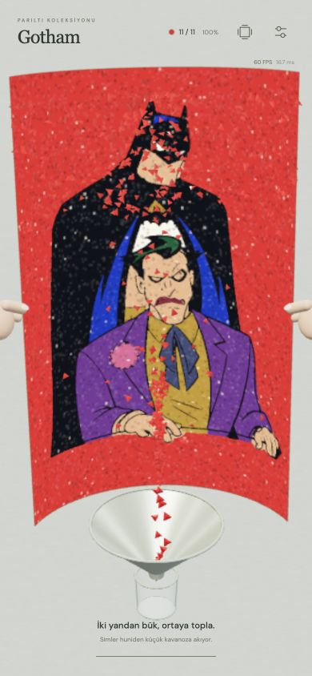
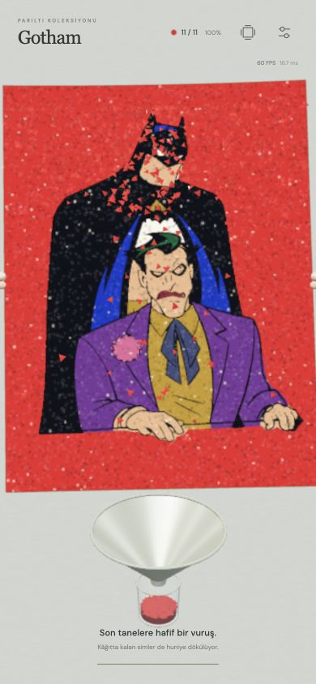
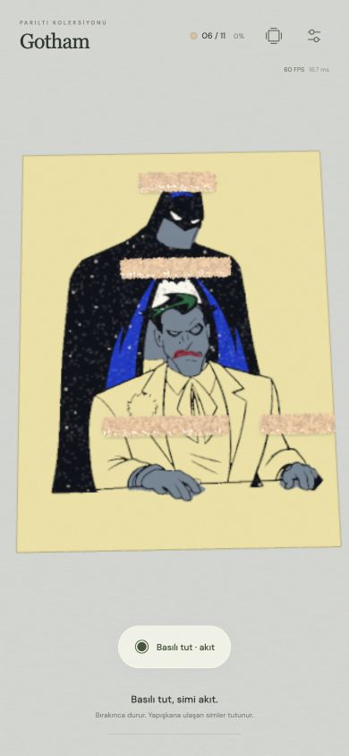
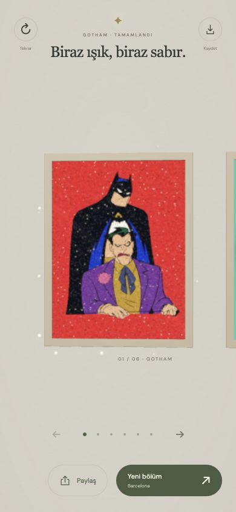
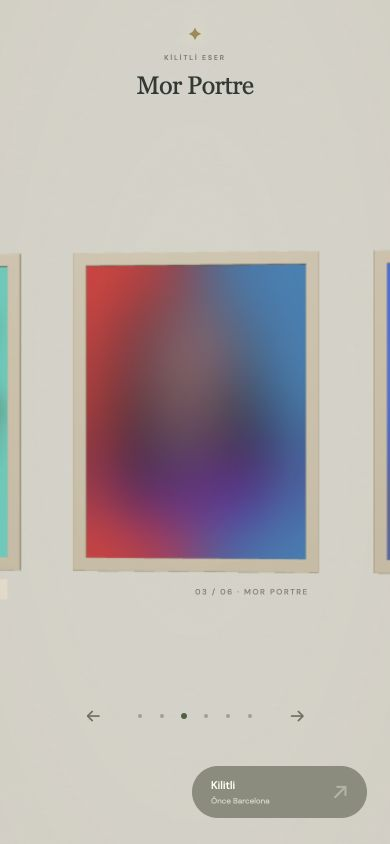

# v21 · Net sergi, hedefli döküş, huni ve son dokunuş

6 Kasım 2026. v20 üzerine gelen iki ekran kaydına ve aynı geliştirme sırasında eklenen küçük soyma/hedefli döküş taleplerine göre güncellendi.

## Görüntü ve sergi

- Birbiriyle kesişen dört çerçeve katmanı, tek opak ve pahlanmış bir çerçeve dudağıyla değiştirildi. 598×798 açıklık, 600×800 resmi az miktarda örter; krem/beyaz paspartu boşluğu yok. Arka panel ayrı ve daha geridedir.
- Kamera yakın düzlemi 1’den 80’e alındı. Mevcut çalışma/galeri/giriş kadrajı değişmeden derinlik ayrımı iyileştirildi. MSAA dokunmatik cihazlarda da istenir; gerçek destek `#art[data-antialias]` ile görülebilir.
- Poster içindeki yüksek frekanslı sinüs/hash parıltısı, mipmap ile filtrelenen sabit bir rastgele dokuya dönüştürüldü. Parıltılar daha küçük ve hafif. Bitiş yıldızları çerçevenin dışına taşındı.
- Kısa bir 36 piksel kaydırma veya yeterince hızlı 10+ piksel hareket, tek tablo ilerletir. Parmak takip edilir; bırakınca hedefe yumuşak oturur. İptal edilen hareket geri döner. Sonlu sıranın başı/sonu korunur.
- Bölüm sırası artık kilitlidir. İlk bölüm baştan açıktır; önceki bölüm bitmeden sonraki oynanamaz. Galeride gezmeye izin verilir, kilitli resimler güçlü bulanıklıkla gösterilir ve giriş düğmesi devre dışıdır. Ayarlar ve doğrudan URL de aynı kuralı kullanır.
- Küçük `sim-atolyesi-progress-v1` kaydı, görüntü geçmişinden ayrı tutulur. Eski galeri tamamlamaları aktarılır; sıra dışı eski kayıtlar, aradaki eksikler tamamlanınca erişilir. Ayarlar ve eski resimler silinmez.

## Soyma ve iOS dokunma

- İlk soyma dokunma beklemeden başlar. Genel hız ve basılı tutarak hızlandırma korunur.
- Küçük parçaların soyma süresi yaklaşık 0,4–1 saniyedir; aradaki boşluk da kısaldı. Büyük parçalarda 2,3–3 saniyelik rulo korunur. Süreler `peelSeconds`/`peelGap` ile aynı modelden üretilir.
- Cımbız genişletildi; koyu dış siluet, tutma yüzeyi ve ince aydınlık şerit eklendi. Tutulan parçanın biraz üstünde görünür.
- Oyun yüzeyinde `touchstart`, `touchend` ve `dblclick` varsayılanları iptal edilir. Pointer/ilk parmak kontrolü korunur; ayar formunun normal dokunması engellenmez. Bu, videodaki iOS büyütecini tetikleyen yerel dokunma davranışına yöneliktir. Fiziksel iOS doğrulaması bu ortamda yapılmış sayılmaz.

## Basılı tut için üç döküş

Ayarlar → Hissiyat → Döküş yerleşimi. Yeni seçimi mevcut renkte denemek için **Bu rengi yeniden dene**.

| Seçenek | Şerit |
| --- | --- |
| Tam sayfa · üst şerit | Önceki davranış. Bir veya iki tam genişlikte sıra. |
| Hedef genişliği · üstten | Hedefin yatay sınırından biraz daha geniş; yine sayfanın tepesinde. |
| Parça üstleri · yerel | Her ayrı soyulmuş parçanın yaklaşık 65 piksel üstünde, o parçadan biraz geniş ayrı şerit. |

Yerel döküşte kap parçalar arasında taşınırken akış kapanır. Şeritler gerçek sonlu paketlerden oluşur; yapışma basılı tutmadan başlamaz. Hedef genişliği ve yerel seçeneklerde gevşek sim dozu toplam şerit uzunluğuna göre ayarlanır. Yoğunluk/boyut/bir–iki sıra ayarları bu yerleşimlerle birlikte çalışır. Görünür eksikleri otomatik boyama toleransı değiştirilmedi.

## Artık sim ve opsiyonel son dokunuş

- Her döküşün rastgele bir artık miktarı, yoğunluk eğilimi ve bölgesi vardır. İnce serpiştirme korunur; sabit yığın adaları eklenmez.
- Kâğıtta kalan parçalar, düşenler ve kavanozdaki üst taneler seçili sim boyutunu takip eder. `dust` artık yalnızca davranış işaretidir; boyutu zorla küçültmez.
- **Son dokunuş** varsayılan açık, ayarlardan kapatılabilir. Seçim sonraki boşaltmaya uygulanır.
- Açıksa mevcut gevşek simlerin rastgele %0–92’sine kadarı ilk bükmede tutulur. Bazı turlarda çok az, bazılarında çoğu son harekete kalabilir. Kaplamaya yapışan simlere dokunulmaz.
- Kâğıt iki yandan bükülür, gevşek simler akar; sonra düzleşirken alt kenarını koruyarak biraz havada tutulur. Birkaç hafif hareket kalan parçaları ayrı gecikme ve yörüngelerle döker. Taneler eklenmez/kopyalanmaz. Kalan malzeme ve düşenler bitmeden sonraki renge geçilmez.
- Kapalıysa önceki tek bükme/boşaltma akışı kullanılır.

## Huni ve kavanoz

Kutu yerine kameraya eğimli bir huni ve ucunda küçük cam kavanoz var. Parçalar koniyle kesişir, dar boğaza doğru kayar, sonra kavanoza düşer. Açıklığı ıskalayan parçalar kavanoza ışınlanmaz.

Huni ve kavanoz aynı yerel koordinat sistemini kullanır. Dolu sim hacmi bütün yakalanan miktarı temsil eder; üst yüzeyde en fazla 2.200 gerçek örnek çizilir. Telefon boyutunda görünmeyen on binlerce üst üste tane tekrar çizilmez. Boyut ve miktar dolumu etkiler. Alt kavanozu örten masa çizim sırası da düzeltildi.

## Doğrulama

- Mevcut 51 renk, klasik şeritte ve iki yeni yerleşimde tam kaplamaya kadar test edilir.
- İlk/son galeri sınırı, kısa swipe, kilit açma ve bozuk/dolu saklama durumları test edilir.
- Huni → boğaz → kavanoz, ıskalama, yapışmış simin korunması ve son vuruşta sonlu malzeme korunumu test edilir.
- Mobil tarayıcı görünümünde gerçek kontrollerle soyma, büyük taneler, son renk, huni, ayar seçenekleri, kilit ve kısa sürükleme kontrol edilir. Bunlar fiziksel telefon FPS/yerel Safari jest ölçümü değildir.

## Son kontrol kaydı

129 test: 51 rengin iki yeni döküş yerleşiminde de tam kaplanması, klasik akış, küçük/büyük soyma süreleri, kilitlerin yeniden yüklemede korunması ve huni/son vuruş malzeme korunumu dahil. Mobil tarayıcıda 50 piksellik iki ayrı sürükleme tek tek Barcelona ve kilitli Mor Portre’ye ilerledi. Hedef genişliği denemesi 1.974 paketle küçük bir şerit oluşturdu; yerel ten rengi denemesi dört ayrı şerit oluşturdu. Her ikisinde de basılı tutmadan kapsama sıfırdı. Bir son vuruşta 172 paket ayrılıp 172’si serbest bırakıldı; renk geçişi tamamlandı. Görüntüde MSAA desteği açık ve kamera yakın düzlemi 80 olarak doğrulandı.

Son dokunuş kapatılarak yapılan gerçek UI denemesinde sonraki renge `lastCleanupHeld=0`, `lastCleanupReleased=0` ile geçildi. Kilitli Naruto URL’si erişilebilir Barcelona’ya yönlendirildi.
