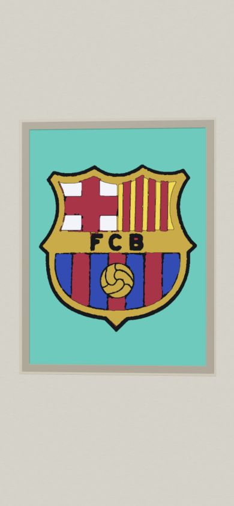
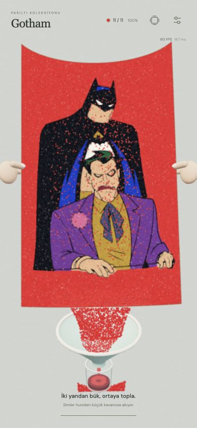

# v22 · Sakin tablo girişi ve ana basılı akış

6 Kasım 2026. Kullanıcının 02:10 ekran kaydı incelendi. Yeni seçenek, mevcut klasik kamera yolunu koruyarak eklenmiştir.

## Tabloya giriş

**Ayarlar → Hissiyat → Tabloya giriş**:

- **Klasik · kay ve yaklaş:** önceki kamera yolu.
- **Doğrudan · sakin yaklaş:** ayrı bir ön pan yapmadan seçili esere tek harekette yaklaşır. Galerideki açı korunur, en yakın noktada bile bütün resim %4 payla kadraja sığar.

`?giris=direct` yeni seçeneği açar ve diğer ayarlar gibi saklar. Kayıtlı seçim yokken klasik yol korunur. Çerçeve her iki seçenekte de girişin %25–90 aralığında saydamlaşır; nesne bir karede silinmez. Çerçevenin ortak malzemesi değiştirilmez; geçişte kopyası kullanılıp sonra atılır.

Tablonun kendisine veya çerçevesine kısa dokunuş oyuna girer. Kaydırma giriş sayılmaz, kilitli tablo açılmaz. Bitmemiş mevcut esere dokunmak oyuna devam eder. Aynı belge, renderer ve sahne korunur. Girişten sonra sevilen geri uzaklaşma ve posterden sarı kâğıda renk dönüşümü önceki zamanlama/formülle çalışır.

## Basılı tut ana varsayılanları

| Ayar | Değer |
| --- | --- |
| Oynanış | Basılı tut · bük ve akıt |
| Yerleşim | Hedef genişliği · üstten |
| Sim yoğunluğu | %500 |
| Sim parçası boyutu | %170 |
| Son dokunuş | Kapalı |

`holdPresetVersion:22`, eski kayıttaki bu beş tercihi yalnız bir kez yeni varsayılana taşır. Kalite, hız ve diğer tercihler korunur; oyuncunun sonraki yoğunluk/boyut/mod değişiklikleri yeniden sıfırlanmaz. Depolama anahtarı değişmedi.

Bu modu etkilemeyen fırça hissiyatı, hareketlilik/tepki, fırça boyutu/şekli, eski doz/döküş stili, eğim hassasiyeti, kâğıdı elle hareket ettirme, düzen, manuel renk ilerletme ve eski rötuş toleransı gizlenir/devre dışı kalır. Başka moda geçince geri açılır. Yığın hacmi, kap görünümü, yapışkan rengi ve görüntü/FPS seçenekleri kullanılabilir.

%90 **üstünde** kalan hedef paketleri 0,30 saniyelik hareketle gerçek hedeflerine ulaşır, ardından normal 0,18 saniyelik oturma hareketiyle yapışır. Yeni malzeme üretilmez veya maskeye anlık boya basılmaz. Tam kaplama oluşunca parmak hâlâ tutulsa da boşaltma başlar. Fırça ve eğimin çok düşük rötuş toleransı değişmedi.

## Huni, dökülen sim ve son dokunuş

Huni tek, yuvarlatılmış kesitli, metalik olmayan mat nane/krema renkli bir yüzeydir. Fizikteki eğimli koni → boğaz → kavanoz akışı korunur. Keskin ayrı metal çember yerine yumuşak kalın ağız kullanılır.

Huni gelmeden kâğıttan çıkan simler 280 ms içinde saydamlaşır. Normal boşaltmada huniye giden simler saydamlaşmaz; fiziksel yörüngeleri ve seçili boyutları korunur. Yalnız dolu örnek aralıkları GPU’ya aktarılır; dökülen taneler de pigment/parıltı shader’ını kullanır.

Son dokunuş açıksa az sayıda gerçek gevşek tane ayrılır: en fazla 24, uygun tanenin %4’ü ve rastgele 6–22 üst sınırından en küçüğü. Ana bükme sırasında hâlâ seçili boyuttadırlar; kâğıt açıldığında yalnız bu son taneler %38 boyuta iner. Yeni tane eklenmez, yapışmış kaplama değiştirilmez.

Cımbızın ikincil tutacağı mercan/bakır tonuna çevrildi. Küçük parçaların soyulması biraz yavaşlatıldı; büyük rulo soyma temposu korundu. Basılı tutarak soyma hızlandırması kaldırıldı. Genel 1x–4x hız seçimi çalışır.

## Doğrulama

`npm run build` ve **137 test** başarılı. Bütün 51 renk, sonlu malzeme korunumu, %90 sonrası gerçek paketlerle tam kaplama, varsayılanların tek seferlik taşınması, kapalı ayarların yeniden açılması, erken simin sönmesi / normal akışın sönmemesi, küçük son taneler, her iki girişte kamera reset sıçraması ve farklı ekran oranlarında resmin kadraja sığması kapsanır.

390×844 tarayıcı görünümünde gerçek kontrollerle:

- %500 / %170 / hedef genişliği / son dokunuş kapalı varsayılanı doğrulandı.
- Basılı giriş kaldırılmadan %100 → huni → sergi tamamlandı; 63.620 paketlik malzeme akışı çoğalmadı.
- Son dokunuş açılan ayrı turda 12 tane tutulup 12’si bırakıldı ve bölüm tamamlandı.
- Tablonun üzerine dokunmak doğrudan girişi başlattı; çerçeve alfa değeri ara karede 0,571 idi. Barcelona’ya geçişte belge oturumu aynı kaldı ve çalışma kamerası eski konumuna döndü.
- Fırça moduna geçince gizli kontroller geri açıldı, basılı ayarları devre dışı kaldı.
- Tarayıcı konsolunda çizim/shader hatası yoktu.

Bunlar masaüstü tarayıcının mobil boyutunda yapılan kontrollerdir; fiziksel iPhone Safari/FPS ölçümü değildir. Canlı yayında Actions sonucu ve dosyaların yerel SHA-256 eşleşmesi ayrıca kontrol edilir.
