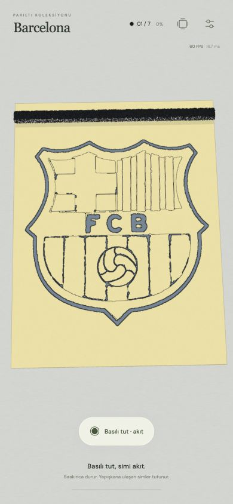

# v23 · Yerel modda ortak döküş

6 Kasım 2026. Yerel mod artık her soyulan parçaya zorunlu olarak ayrı şerit dökmez. Bir üst döküş aşağıdaki parçaları da besleyebiliyorsa, onların döküşleri kaldırılır.

- Geniş üst akış tercih edilir; en küçük/alttaki gereksiz kaynaklar önce elenir.
- Birden fazla üst şeridin birleşen yatay akışı da alttaki ayrı döküşün yerini alabilir.
- Üst akışın yanından dışarı taşan hedefler veya daha yukarıda kalan hedefler için gerekli ek kaynak korunur. Geniş ama aşağıdaki bir döküş yukarıdaki alanları boyayamaz.
- Tüm hedef paketleri kalan gerçek üst kaynaklara yeniden bağlanır. Yalnız şeridi saklamak veya alt kısımları otomatik damgalamak söz konusu değildir.
- Gevşek sim dozu, kap hareketi ve döküş süresi kalan şeritlerden hesaplanır. Yoğunluk/tane boyutu ve bir/iki sıra seçimi korunur. `holdPresetVersion` hâlâ 22’dir; bu güncelleme kullanıcı tercihlerini yeniden sıfırlamaz.

Kullanıcının Şapkalı Portre ilk rengi: **8 kaynak → 1 geniş kaynak**. İki sıra seçiliyse bu ortak kaynak yine iki sıra dökülür. Barcelona siyahı **5 → 1**, Gotham ten rengi **4 → 3**, Şapkalı Portre yeşili **16 → 6** gerekli kaynak kullanır.

## Doğrulama

`npm run build`, **141 test** ve `git diff --check` başarılı. İki hedefli yerleşimde bütün 51 renk tam kaplanır; seçili kalan kaynağın hedefin üzerinde ve yatay erişiminde olduğu, erken boyama olmaması ve sonlu malzeme korunumu kontrol edilir. Fotoğraftaki Şapkalı Portre rengi bir ve iki sıra için ayrıca tam kaplamaya kadar denenir. Üstü boyayamayan alt kaynak, yan taşma, iki üst kaynağın ortak kapsamı ve aynı yükseklikteki tekrarlar için regresyonlar vardır.

390×844 gerçek oyun arayüzünde Barcelona’nın beş soyma parçası sonrasında tek şerit oluştu. Basılı tutmadan kapsama sıfırdı. Basılı tutunca aynı 55.713 paketle %100 kaplama ve otomatik huni boşaltması başladı. Fiziksel iPhone FPS testi değildir.

