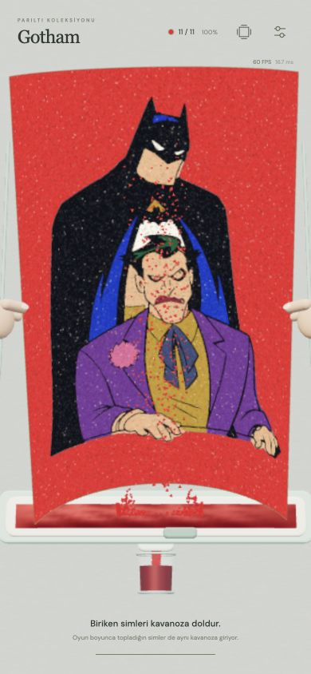
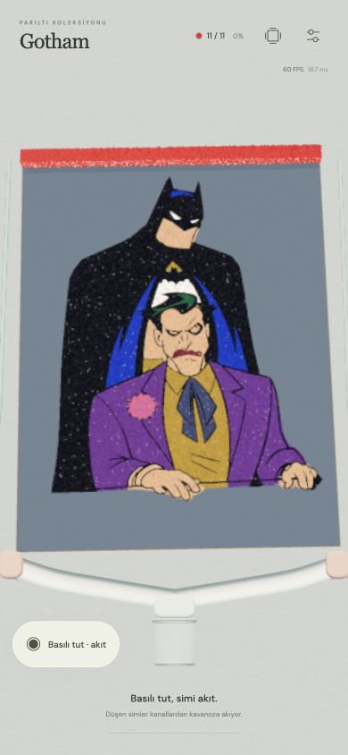
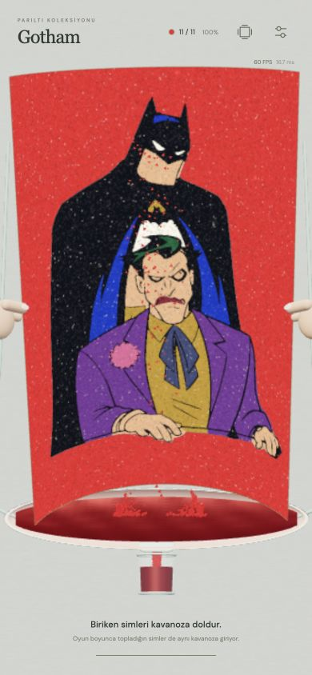
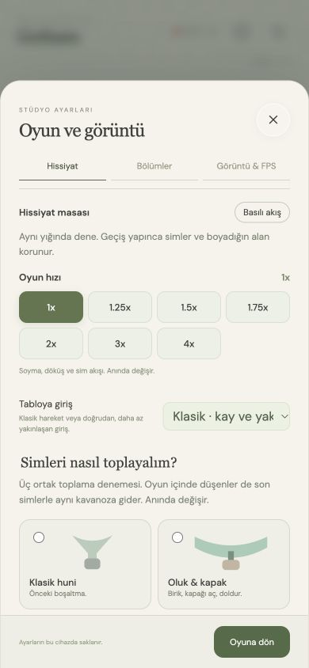

# v24 · Ortak toplama laboratuvarı ve huni performansı

6 Kasım 2026. [Görsel deneme masası](v24-collection-lab.html).

## Üç yeni seçenek

Ayarlar → Hissiyat → **Simleri nasıl toplayalım?**. Mevcut **Klasik huni** korunur ve kayıtlı seçim yokken varsayılandır.

| Düzen | Oyun sırasında | Son boşaltma |
| --- | --- | --- |
| Oluk & kapak (`trough`) | Geniş, yuvarlak kenarlı nane renkli olukta birikir. | Ortadaki kapak yana kayar, biriken sim aynı kavanoza akar. |
| Çift kanal (`rills`) | İki açık, yumuşak kanal simi sürekli kavanoza iletir. | Ayrı bir huni gelmez; kâğıdın son bükmesi aynı sisteme dökülür. |
| Eğilen çanak (`bowl`) | Şeftali renkli oval çanakta sim birikir. | Çanak ve içindeki sim yüzeyi birlikte eğilir, kavanoza boşalır. |

Toplamanın başından sonuna aynı sistem görünür. Üst/yan kenardan çıkan simler kâğıdın arkasına ve dış yan raylara gider; ön yüzü keserek aşağı düşmez. Alt kenar doğrudan geniş toplama yüzeyine iner. Üç deneyde oyun sırasında düşenler kaybolmaz. Klasik modda v22’nin 280 ms kenar sönmesi korunur.

`?toplama=trough`, `rills`, `bowl` veya `classic` bir denemeyi doğrudan açar. Seçim ayarlar anahtarına eklenmiştir; v22 ana mod/yoğunluk/boyut geçişi tekrar uygulanmaz. Panelden seçim değişince deneme URL’si de eşitlenir. Mevcut sim miktarı ve kavanoz dolumu korunur. Yoğunluk, tane boyutu, hız, yerel döküş ve isteğe bağlı son dokunuş birlikte çalışır.

## Malzeme ve çizim

`Recovery` tam sayı kütle hesabını tutar: `stored + inTransit + jar === deposited`. Gerçek kâğıttan çıkan taneler hazneye ulaşınca hesaba girer. Hazneden çıkan görsel aktarım paketlerinin her biri birkaç taneyi temsil edebilir; temsil ettiği miktar hazneden bir kez eksilir, kavanoza bir kez eklenir. Yeni malzeme yaratılmaz. Hazne yüzeyi ve kavanoz hacmi bütün miktarı gösterir; görünmeyen üst üste on binlerce sim ayrı ayrı çizilmez.

En fazla fizik adımı başına 48 aktarım paketi başlatılır. Çizilen tane boyutu seçili değeri izler; paket ağırlığı tane ölçeğini büyütmez. Oyun sırasında toplanan miktar final başında sıfırlanmaz. Renk, bütün yoldaki ve haznedeki miktar kavanoza ulaşmadan değişmez. Yeni renkte hesap temizlenir.

FPS panelinde **Toplanan / kavanoz** sayıları vardır; görünür örnek sayısı toplam malzeme miktarından farklıdır. Yeni deneylerde basılı tut düğmesi kavanozu kapatmamak için sola geçer; tüm kâğıda basılı tutma da çalışır.

## Performans çalışması

- Dünya fiziği küçük adımlarda sürer; sim matrisi/renk/opacity yüklemesi fizik adımı başına tekrar hazırlanmaz, görüntü karesi başına bir kez hazırlanır.
- Hareketli sim matrisleri ara `Object3D` güncellemeleri yerine dolu örnek aralığına yazılır. Kâğıttan ayrılmada her taneye iki geçici `Vector3` üretimi kaldırıldı.
- Kavanoza yakalanan bütün taneler sayılır. Yalnız en fazla 2.200 üst örneğin matrisi kare başına hazırlanır; boşaltmadaki on binlerce yakalama için aynı matrisler tekrar tekrar hesaplanmaz.
- Tam opak huni akışı derinlik yazar. Kısa kenar sönmesi dışında yoğun akışın saydam katman yükü kaldırıldı.
- Huni çarpışma hesabındaki geçici koordinat nesneleri kaldırıldı. Önceki fizik yörüngeleri ve yakalama sonuçları sabit v23 örnekleriyle korunur.
- Geç gelen huni/akış malzemeleri, başlangıç soyma sırasında görünmeyen küçük bir sahnede asenkron hazırlanır.
- Temizliğin başındaki gereksiz tam canvas bake’i kaldırıldı; canlı GPU kaplama korunur. Gereken bitiş bake’i renk değişiminde yapılır.

`node scripts/benchmark-collection.mjs` v23 commit’i `94a5a13` ile karşılaştırır. Node 22.23.4; üç koşunun medyanı, 67 ölçülen kare. Bu sadece CPU fizik/örnek hazırlama ölçümüdür, bütün oyunun kare süresi veya fiziksel telefon GPU/FPS ölçümü değildir.

| Tane / hız | Önce ortalama | Sonra ortalama |
| --- | --- | --- |
| 12.000 / 1x | 3,03 ms | 1,69 ms |
| 48.000 / 1x | 11,66 ms | 5,95 ms |
| 48.000 / 4x | 16,09 ms | 8,78 ms |

4x koşusunda iki uygulama da aynı **21.903** taneyi yakaladı. [Ham ölçüm](handoff/v24-collection-benchmark.json).

## Görsel araştırma

Özgün üç oyun içi deneme aşağıdaki kaynakların biçim/akış özellikleri düşünülerek geliştirildi; ürün görselleri asset olarak kopyalanmadı.

- [MOLUK Pluï Rain Cloud](https://www.moluk.com/products/plui-rain-cloud-bath-toy): yuvarlak oyuncak formu ve kontrollü bırakma.
- [tickit Discovery Table & Trays](https://www.tickit.co.uk/products/sensory-mood-discovery-table-discovery-tray-set): geniş kenarlı toplama yüzeyi, görünür malzeme birikimi.
- [Iowa State Extension Sand and Water Exploration](https://www.extension.iastate.edu/cedar/files/documents/Sand%20and%20Water%20Exploration%20A.pdf): kap, huni ve aktarım araçları araştırması.

## Kontroller

147 test geçti. Kütle korunumu, 1x/4x boşaltma, kapalı kapak, bütün kâğıt kenarları, eski huni yörüngeleri, örnek sınırı ve ayar kalıcılığı kapsanır. Önceki 51 renk ve oyun döngüsü testleri de korunur.

390×844 tarayıcı görünümünde üç deney ve klasik mod oynandı. Oluk, çift kanal ve çanakta son rengin **52.413** kayıp/gevşek tanesi aynı kavanoza ulaştı; hazne ve yolda kalan miktar sıfırdı. Normal ayardaki oluk boşaltmasında arayüz 60 FPS, 1,6 ms simülasyon CPU ve 1,6 ms çizim CPU gösterdi. Klasik huni %500 / tek sıra / 1x ile boşaltmanın ikinci saniyesinde 60 FPS, 2,7 ms simülasyon CPU ve 2,5 ms çizim CPU gösterdi. Bunlar masaüstü tarayıcı ölçümleridir. Klasik mod maksimum %800 yoğunluk, iki sıra ve 4x hızda da tamamlandı; bu aşırı ayar hâlâ ağırdır ve telefon için 60 FPS garantisi verilmez. Konsolda çizim/shader hatası görülmedi.

