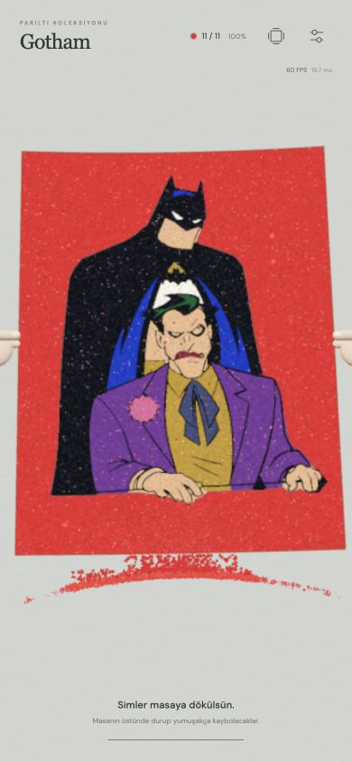
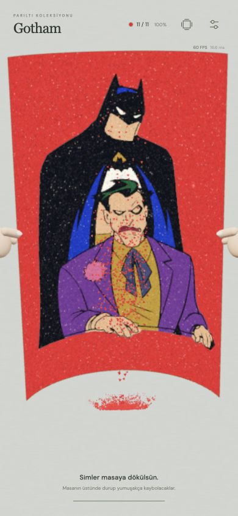

# v25 · Gerçek akış azalması ve masada kalan sim

6 Kasım 2026. Kullanıcının Barcelona 05/07 ekranı ve iki isteği üzerine.

## Yapışma gerçekten stoğu tüketir

Önceki basılı akışta tek bir paket 5×5 hücrenin görüntüsünü kaplıyor, kalan yoğun şerit oradan geçmeye devam ediyordu. Şimdi ilk kaplama sonrasında o gerçek yapışkan piksele temas eden ek serbest taneler de 0,18 saniyede oturup `BOUND` olur. Hücre kapasitesi yapışkan piksel alanı ve döküşteki tane boyutuyla belirlenir. Yeni sim eklenmez, akış keyfî olarak silinmez veya ölçeği küçültülmez.

`Sand.bindLayer` mevcut kaplanmış hücreye gerçek bir taneyi bağlar; aynı alanın kapsamasını tekrar saymaz. `HoldCascade` oturan tanelerin yerlerini rezerve eder, kapasiteyi aşmaz; bırakınca bu temas hareketi de durur. Son taneler oturmadan otomatik temizleme başlamaz. Önceki seyrek son artıklar korunur. Fırça/eğim modu değiştirilmedi.

Gerçek UI kontrolünde Barcelona sarısında aynı **30.161** başlangıç paketinden ilk hücre kaplamasına ek **2.404** tane yapıştı. Gotham’ın son kırmızısında **63.620** paket = **51.421 bağlı + 12.199 dökülen**; bunların **40.214** adedi ek oturma hareketiyle gerçek stoktan bağlandı. Görünür akış bu yüzden seyrelir.

## Yeni seçenek: Masada kalsın

Ayarlar → Hissiyat → Simleri nasıl toplayalım? → **Masada kalsın**. Doğrudan: `?v=25&mod=basili&toplama=table`.

Bu modda huni, tepsi veya kavanoz gösterilmez. Hem oyun içi kenar döküntüsü hem son bükme/silkeleme parçaları **gerçek masa düzlemine** yerçekimiyle iner. Masanın altına geçmez; çarpışmadan sonra konumları sabittir. 0,45–0,75 saniye bekleyip 0,65–0,90 saniyede yumuşakça sönerler. Bu süreler oyun hızıyla birlikte değişir. Üst/yan döküntüler kâğıdın arkasında kalabilir; öne yapıştırılmış bir alt akış yoktur.

Klasik huni, oluk, çift kanal ve çanak seçenekleri korunur. Yeni seçenek kaydedilir; yoğunluk/boyut/ana mod tercihleri yeniden sıfırlanmaz. Mevcut ortak toplama miktarı masa moduna geçerken kaybolmaz; geçiş paketi masada sönerse `Recovery.cleared` hesabına gider. Performans panelinde masa modunda **Masaya inen / sönen** ve **Masadaki sim aktarımı · KB/kare** gösterilir.

## Takılma için yapılan iş

- Yerleşmiş masa taneleri ayrı bir örnek havuzuna sadece bir kez yazılır. Bekleme/sönme GPU saatinden hesaplanır; her kare tüm tanelerin pozisyon/renk matrisleri hazırlanıp aktarılmaz.
- Havuz döküşten önce gereken miktara büyütülür. Yeni inen aralıklar yüklenir; sabit tanelerde kare başına aktarım sıfırdır. Alfa hash ile derinlik yazımı korunur; yoğun saydam katman yükü azaltılır.
- Son bükmede artık kullanılmayan komşuluk, basınç ve yığın ızgarası hesapları atlanır. Havada tane varsa önceki tam çözücü kullanılır. Serbest tanelerin bükme yörüngeleri, bağlılar ve son dokunuş için tutulanlar kayıtlı v24 örnekleriyle aynıdır.

Node 22.23.4, üç koşunun medyanı, yalnız ilgili CPU işi; GPU ve bütün oyunun kare süresi hariç:

| İş | Önce | Sonra |
| --- | --- | --- |
| 48.000 yerleşmiş tanenin kare hazırlığı | 2,08 ms; 4.032.000 bayt/kare | ≈0,001 ms; 0 bayt/kare |
| 48.000 tanelik kâğıt boşaltma fiziği | 1,74 ms | 0,63 ms |
| 96.000 tanelik kâğıt boşaltma fiziği | 2,87 ms | 1,27 ms |

Script’ler: `scripts/benchmark-table.mjs`, `scripts/benchmark-drain.mjs`. [Masa ham ölçümü](handoff/v25-table-benchmark.json), [boşaltma ham ölçümü](handoff/v25-drain-benchmark.json). İlk iniş ve yeni tane yüklemesi bu sabit-tane ölçümüne dahil değildir; fiziksel telefon FPS garantisi değildir.

## Kontroller

153 test geçti. Bütün 51 renk, gerçek bağlı tane / stok eşitliği, yapışkan dışına bağlanmama, basılı tutmayı bırakınca donma, dört masa kenarı, masayı delmeme, sabit konumda sönme, GPU verisini yeniden yüklememe, renk sonu temizlik ve eski bükme yörüngeleri kapsanır.

390×844 gerçek tarayıcı arayüzünde Barcelona 05/07 oynanıp sonraki renge geçti. Gotham son renginde 12.199 tane masaya indi, 12.199’u söndü; aktif tane sıfırla sergiye geçildi. Normal boşaltma görüntüsünde 60 FPS, yaklaşık 1,1 ms simülasyon CPU ve 2,2 ms çizim CPU görüldü. %800 / iki sıra / 4x / son dokunuş açık stres denemesinde 95.067 paket = 61.819 bağlı + 33.248 dökülen; 33.248’i masada sönüp bitiş gerçekleşti, tutulan 14 küçük tane de bırakıldı. Bu aşırı ayar hâlâ ağırdır. Fiziksel iPhone testi yapılmış sayılmaz. Konsolda shader/çizim hatası yoktu.

