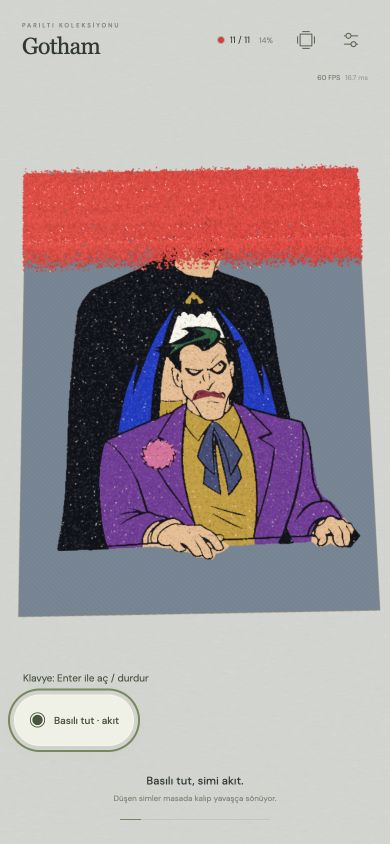
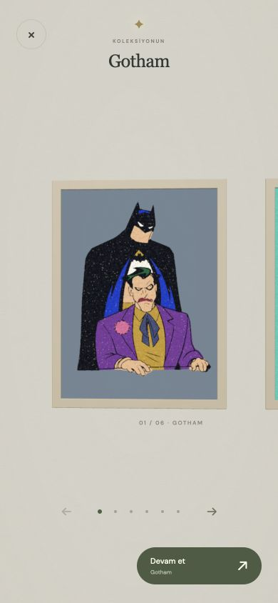

# v29 — Videoda kalan aktif renk

Kullanıcının 6 Kasım 15:01:32 kaydı 3,15 saniye. 24 zaman örneğinde incelendi. Afro Çocuk'un 8/8 pembe renginde kapsama yaklaşık %11: çalışma alanındaki yoğun üst şerit, yaklaşık 1,5. saniyede sergiye geçince azalıyor; fakat yapışmış pembe benekler çerçevenin üst solunda görünür kalıyor. Bu kayıt yeni çerçeve girişini veya boşaltma sonunu göstermiyor; onlar hakkında bu videodan yeni bulgu çıkarılmadı.

## Neden

v28 yalnız hareketli tane, yığın ve düşen tane çizimini söndürüyordu. Aktif rengin yapışmış hedef hücreleri kağıt kaplamasıydı; bu ayrı çizim katmanı görünür kalıyordu. Ayar değişince aktif kaplama CPU kağıdına da bake edilebildiği için yalnız shader'ın canlı boyasını kısmak yeterli olmazdı.

## Düzeltme

- `displayPaper`: çalışma render altlığı. Koruyucu kağıt/yapışkan, önceki tamamlanmış renkler ve çizgiler. Aktif kaplama burada bake edilmez.
- `paperCanvas`: mevcut tam poster/export/galeri kaydı. Önceki gibi aktif kaplama da içerilir.
- Aktif rengin kaplaması `uActiveAlpha` ile serbest simle birlikte yumuşakça gizlenir ve geri gelir. Parıltı da o maskede aynı şekilde söner; hayalet benek bırakmaz.
- Önceden bitirilmiş renkler görünür kalır. Tane durumları, bağlanan miktar, kapsama ve stok değişmez. Fizik sergide durur.
- Bölüm tamamen bitince aktif kaplama alfa 1'dir; son renk tamamlanmış posterde, kayıtta ve export'ta kaybolmaz.
- Ek tam tuval kompozisyonu yalnız mevcut `repaintPaper` çağrısında yapılır. Geçişin her karesinde CPU bake yapılmaz; fade bir shader uniformudur.

## Doğrulama

Build ve 160 test başarılı. 390×844 mobil tarayıcıda Gotham son kırmızıyla benzer kısmi yapışma durumu oynandı: sergiye çıkmadan ve döndükten sonra kapsama **0.13994**, BOUND **7.842**, emitted **63.620** kaldı. Aktif görünürlük 1 → 0 → 1; sergide kırmızı iz yok, önceki renkler görünür. Tane boyutu değiştirilip CPU bake tetiklendikten sonra da kontrol edildi. %100 → temizlik otomatik geçişi çalışır. Konsolda shader hatası yok. Fiziksel iPhone testi değildir.

