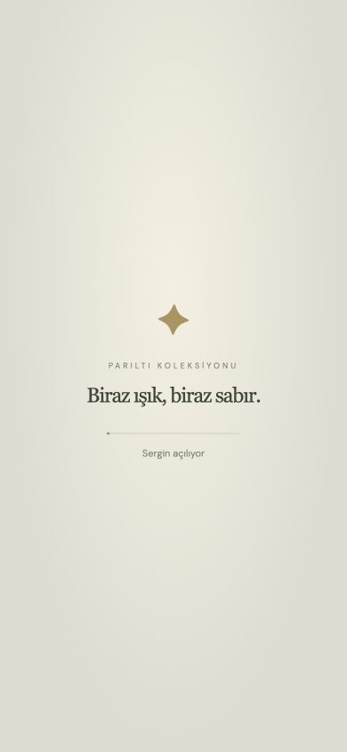
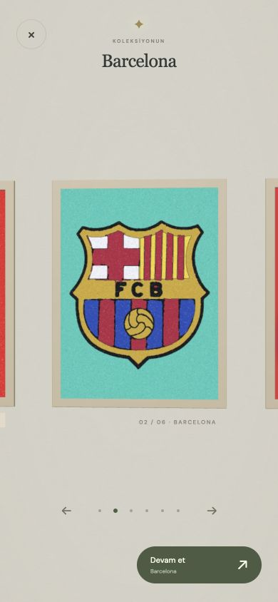

# v30 — Bitiş sayacı ve açılış

## %100 sonrasında bekleme

Ekran görüntüsü Barcelona 7/7, %100, “Son taneler yerleşiyor” durumundaydı. Bekleme kapısı `pendingLayerCount === 0` idi. Kenardaki temas noktası JavaScript double ile yapışkanda görünürken Float32 konuma yazıldığında komşu boş piksele yuvarlanabiliyordu. Yapışma reddedilince eski kod aynı rezervasyonu her kare tekrar düşüyordu; sayaç negatif kalıp bitişi engelliyordu. LOST/BOUND olarak ayrılan bir temasın rezervasyonu da açık kalabiliyordu.

Eski sürümle küçük deterministik sınır testi: gerçek yazılan Y=500, pending=1; 100 adım sonra pending=-89, Uint8 hücre sayacı=167. Yeni sürümde aynı nokta kontrol öncesi Float32'ye yuvarlanır; yapışkana değmiyorsa hiç rezerve edilmez. `releaseLayer` var olan rezervasyonu bir kez kapatır. Reddedilen temas tekrar tekrar “yerleşme” sayılmaz; mevcut serbest tane akışa devam eder. Bitirme başlayınca yeni ek katman rezervasyonu açılmaz. Malzeme silme, süre dolunca zorla %100 boyama veya kapsama toleransı değişikliği yoktur.

## Açılış

1. İlk HTML boyamasından itibaren tam ekran yükleme görünümü. Oyun inert/gizlidir; oyuncu arada yanlış tablo/oyun UI'sı görmez.
2. Maskeler, mevcut renk sınırı, galeri resimleri ve koleksiyon shader hazırlığı beklenir.
3. İki gerçek render karesinden sonra yükleme görünümü yumuşakça söner. Kamera başlangıçtan itibaren sergide, kayıtlı tabloya odaklıdır.
4. “Devam et” veya tabloya dokunma aynı yumuşak giriş animasyonuyla mevcut renk aşamasına girer. Bitmiş eserlerde yeni bölüm/yeniden oyna sunulur.

`AtelierSession` → `sim-atolyesi-session-v1`: son galeri odağı, her tablo için mevcut renk indeksi ve bitmişlik. Kayıt renk geçişlerinde ve odak seçiminde yapılır; kare başına localStorage yoktur. Tamamlanan renkler yeniden hazırlanır; yarım rengin aktif sim dizisi saklanmaz, o renk baştan hazırlanır. Mevcut ayarlar/geçmiş/kilit anahtarları değişmez. Yeni kaydı olmayan eski kullanıcıda açık URL, en son biten kayıt veya ilk açık tablo güvenli başlangıçtır; önceki sürümde kaydedilmemiş bir sahnenin nerede bırakıldığı tahmin edilemez. Kilitli tablo odağı hatırlanabilir ama oynanamaz. `bolum` açık bağlantı ve `devam` QA kısayolu korunur.

## Kontrol

Build ve 165 test başarılı: eski sayaç hatasının sınır koşulu, iptal/LOST rezervasyonlarının tek sefer kapanması, yenilemede renk sınırı/son tablo, eski/bozuk/dolu kayıt, kilit kontrolü.

390×844 gerçek tarayıcı UI'sında Barcelona son rengi %100 → pending=0 → boşaltma → complete akışı; genel URL'den yeniden açılınca Barcelona bitmiş sergisi; oradan Mor Portre'ye aynı oturumda giriş kontrol edildi. Fiziksel telefon FPS testi değildir.

