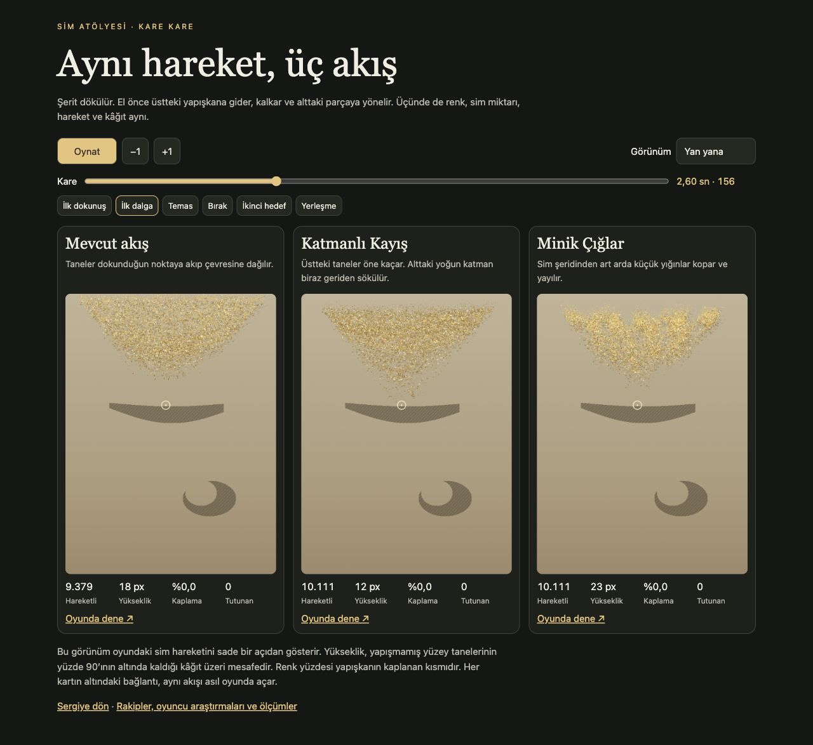

# Sim Atölyesi oyun araştırması ve malzeme denemeleri

10 Kasım 2026 · v38

[Üç akışı kare kare karşılaştır](https://furkiti.github.io/sim-atolyesi/material-lab.html?v=38) · [Atölyeyi aç](https://furkiti.github.io/sim-atolyesi/?v=38&akis=point&malzeme=avalanche&giris=direct)

## Aynı kategoride üç ayrı rekabet alanı

| Oyun | Kanıt | Karar ve Sim Atölyesi için anlamı |
| --- | --- | --- |
| **Sand ASMR Coloring · Mad1 Games** | Yayıncının mağaza sayfası, ekranları ve Google Play’de görünen **1M+ indirme** | Birebir yakın döngü. Maske soyuluyor, renk seçiliyor, kum dökülüyor ve bir sonraki parça açılıyor. Her beşinci bölüm bonus. Bitmiş görsele holografik ve çift renkli kaplama eklenebiliyor. Üretici gerekçesi yayımlanmamış. Benim çıkarımım, oyun içinde kolay tekrar ve sonunda eseri kişiselleştirme diye iki ayrı ödül kurdukları. Bizde fark yaratabilecek an, biriken simin fırçaya veya kâğıda fiziksel tepki vermesi. [Google Play](https://play.google.com/store/apps/details?hl=en&id=com.mad1.sand.asmr.coloring) |
| **Glitty** | App Store ve geliştiricinin gösterim videosu | Yapışkan katmanların üstüne sim dökülüyor. İki boyama biçimi var ve yayıncı sesi de ürünün parçası olarak sunuyor. Mağazadaki bir yorum, eksik yeri gösteren düğmeyi özellikle övüyor. Tek yorum, hedefi bulma problemine örnek. Bizim tablomuzda büyük parçanın üstü sürekli işaretlenirse desen kayboluyor. İlerleme sonunda yalnızca boş cepleri göstermek daha dengeli. [App Store](https://apps.apple.com/us/app/glitty-color-by-sprinkling/id1514230501) · [Gösterim videosu](https://www.youtube.com/watch?v=8q_noPTFk2M) |
| **Cozy Coloring ASMR** | Yayıncının mağaza sayfası | Kumu elle ve eğerek yönlendirme, tırmık, üfleme, hızlı doldurma, arayüzü gizleyen Zen modu ve galeri tek üründe. Araç sayısı derinlik sağlayabiliyor. Bizim ilk girişte bir hareketi öğretme, eğimi ve araçları isteğe bağlı gösterme kararımı destekleyen bir karşı örnek. [App Store](https://apps.apple.com/us/app/cozy-coloring-asmr-sand-art/id6809803482) |
| **Pixel Flow** | Loom ekibi söyleşileri, resmi kurallar, bağımsız oyun günlüğü | Şişedeki sayı gibi okuyabildiğin sınırlı mühimmat, dolaşan taşıyıcı, geri çağırma ve ayrı bekleme yuvaları var. Ekip, blok kaldırmanın anlık tatminini sınırlı alan ve bulmaca çözmeyle birleştirmeyi hedeflediğini söylüyor. Scopely Şubat 2026’da 10M+ oyuncu ve ABD’de aylık gelirde ilk 20 bildirdi. Rakamlar şirket beyanı. Bizim Püskürtücü’ye uyan desen, **bir hamle yap, sonucu gör, sıra yeniden anlam kazansın**. [Ekip söyleşisi](https://www.wired.com.tr/turkiye-nin-en-hizli-unicorn-u-loom-games-h) · [Scopely açıklaması](https://www.scopely.com/en/news/scopely-to-acquire-majority-stake-in-breakout-mobile-game-pixel-flow-and-the-development-team-behind-it) · [Kurallar](https://apps.apple.com/us/app/pixel-flow/id6751056652) |
| **This Is Blast** | Kullanıcının gönderdiği reklam kaydı ve Voodoo’nun sayfası | Renk seçimi altta, vuruş ve sonuç üstte. Kamera sabit. Şişe hedefe erişemediğinde sayı korunuyor. Alttaki hattı değiştirmek için sıradaki şişeyi seçiyorsun. Bizim uyarlamada oyuncunun bakışı resimde kalmalı. Doğru renk açıkken ateşin görsel olarak başlaması ve sayının temasla birlikte düşmesi aynı kararı anlatıyor. [Voodoo](https://voodoo.io/games/this-is-blast) · [App Store](https://apps.apple.com/us/app/this-is-blast/id6738323233) |
| **Sand Blocks · Rollic** | Bölüm 20 kaydı, yayıncının yardım merkezi | Rengi eşleşen kaba taşıma, bekleme alanını kullanma ve süre yönetimi var. Kum sütunu fiziksel olarak boşaldığı için oyuncu neyi başardığını sayıya bakmadan da okuyabiliyor. Kâğıt moduna alacağımız unsur **akışın gözle küçülmesi**. Kronometre ve tıkanma baskısı, atölye hissinden ayrı bir oyun kimliği. [Bölüm 20 kaydı](https://www.youtube.com/watch?v=FgY97WuuA9Y) · [Rollic yardım merkezi](https://rollic.helpshift.com/hc/en/35-sand-blocks/?p=web) |
| **Food Hunt · Color Block Jam · Happy Color** | Mağaza, Rollic geliştirici söyleşisi ve X-Flow rehberi | Food Hunt süre baskısı olmadan dolan yuvalarla gerilim yaratıyor. Color Block Jam ekibi basit giriş ve ilerledikçe yeni strateji hedeflediğini anlatıyor. Happy Color, bulması zor küçük bölge için ampul kullanıyor. Atölyede ilk renk tamamlama ve küçük eksikleri bulma, Püskürtücü’de ise yuva planlama ayrı ayrı öğretilebilir. [Food Hunt](https://apps.apple.com/us/app/food-hunt-pixel-puzzle/id6769314786) · [Rollic ekip söyleşisi](https://rollicgames.com/highlights/hit-stories-is-back-the-success-story-of-color-block-jam) · [Happy Color yardım](https://xflowgames.com/faq.html) |

10 Kasım’daki ücretsiz iPhone bulmaca listelerinde Food Hunt Türkiye’de 3. sıradaydı. Sand Blocks ABD’de ilk 10’daydı. Sıra anlık bir pazar sinyali. Bu verilerle bir özelliğin satış veya elde tutma etkisi ayrı ayrı hesaplanamaz. [Türkiye listesi](https://apps.apple.com/tr/iphone/charts/7012?chart=top-free&l=tr) · [ABD listesi](https://apps.apple.com/us/iphone/charts/7012?chart=top-free)

## Oynadığım deneyler ve kayıt çözümlemesi

**Thisissand.** Boş çalışma alanında iki farklı yükseklikten döktüm. Üstten bırakınca göz önce ince tanecik kolonunu takip ediyor, aşağıda hazır yığına varınca yeni katmanın konturu genişliyor. Döküşü bırakınca havadaki son taneler inmeye devam ediyor. Bir sonraki rengi eski yığının üzerine döktüğümde eski rengi yokuş boyunca örten yeni bir kabuk oluştu. Tek hareketin üç ayrı görsel karşılığı var. Kaynak, uçuş ve yığının omzu. Tasarımcılar amaçlarını renk ve sesle serbest oyun alanı kurmak olarak açıklıyor. Bizim için en değerli kısım yığının dolu görünmesi kadar serbest tanenin katmana dönüşümünü izleyebilmek. [Oynanabilir Thisissand](https://thisissand.com/) · [Tasarımcıların proje yazısı](https://thisissand.wordpress.com/2008/05/12/play_with_us/)

**Sandspiel ve Powder Game.** Sandspiel’da bir duvar çizdim, aynı duvarın üstüne önce kum, sonra su döktüm. Kum eğimli bir tepe ve belirgin bir kenar bıraktı. Su yayılıp engelin kenarından taştı. Powder Game’de taneleri iki noktaya bırakıp çizgi boyunca sürüklediğimde küçük noktalar koyu fonda ayrı ayrı okunuyordu. Sandspiel yaratıcısının teknik yazısında malzemelerle akışın farklı çözüm katmanları olduğu anlatılıyor. Bize taşınacak sonuç kuru yığının omzu, hareket eden taneler ile sabit yatağın ayrımı ve zemini örten sürekli bir parlak zar kullanmamak. [Sandspiel](https://sandspiel.club/) · [Geliştirici yazısı](https://maxbittker.github.io/making-sandspiel/) · [Powder Game](https://dan-ball.jp/en/javagame/dust/)

**Color Pixel Art Classic.** Kedi seçince kısa görsel öğretici açıldı. İlk palet rengi siyah ve hedefleri küçük koyu işaretler. Yanlış bölgeye bastığımda gerçek boya oluşmadı. Sol kulağın sınırına yaptığım doğru dokunuşlar hemen siyah piksele dönüştü. İkinci rengi seçince siyah dolgu kaldı, işaretler yeni rengin hedeflerine taşındı. Tek bakışta sıradaki iş ile yapılan iş ayrılıyor. Sim Atölyesi’nin kâğıt üzerinde oynayan bir hedefi var, bu yüzden işareti simin altına gömmeden ve kaplamanın üstüne taşırmadan göstermek gerekli. [Oynanabilir Color Pixel Art Classic](https://play.famobi.com/color-pixel-art-classic)

### Kayıtta hamle ve sonuç

| Kaynak ve an | Gözlenen | Tasarım okuması |
| --- | --- | --- |
| **This Is Blast · 0,25–1,65 sn** | Mor şişe beş yuvadan ilkinde. Sayaç yaklaşık 44 → 38 → 32 → 26. Mor parçalar alt sınırda azalıyor. | Sayaç ile resimdeki değişim aynı olayı iki yerden anlatıyor. İlk hamle hedef bulduğu sürece oyuncu beklerken de ilerlemeyi görüyor. |
| **This Is Blast · 2,1–3,5 sn** | Mor şişe 23 civarında bekliyor. Alt sırada ağırlık siyah ve sarıda. Örnek el ikinci rengi işaret ediyor. | Bekleme, yeni hamle için ipucu. Tek başına sıfırlanmayan sayı anlaşılmaz kalabilir. Canlı Püskürtücü’de açık renkle kapalı rengin ayrımı bu yüzden önemli. |
| **This Is Blast · 4,4–6,3 sn** | Siyah şişe ikinci yuvadan ateş etmeye başlıyor. Siyah sayaç yaklaşık 50 → 45 → 39 → 33. Mor yeniden azalmaya başlıyor. | İki şişenin durumunu aynı anda okuyabiliyorsun. Siyahın ilk atışından önce mor 21’e inmiş görünüyor. Yeni rengin eskisini açma etkisini bu reklamdan ayrı sınamak gerekir. |
| **Pixel Flow · 12,3 ve 32,3 sn** | İlk bölümde pembe atıcı ray üzerinde, altındaki beş cep boş ve kapasite 4/5. İkinci bölümde dört atıcı aynı anda dönüyor, kapasite 1/5. Mor atıcı 9 mühimmatla alt cepte kalmış. | Ray hareketin zamanını, cepler sonraki seçimleri gösteriyor. İkisini aynı sayaçla anlatmadıkları için bir doluluk diğerinin önüne geçmiyor. [İlk on bölüm kaydı](https://www.youtube.com/watch?v=W_ILad-El9w) |
| **Glitty · 5, 13,6 ve 20 sn** | 5. saniyede balkabağının altında renk paleti, gövdesinde canlı turuncu ve henüz gri üst parça var. 13,6. saniyede tek boynuzlunun yelesi parlıyor, yüz hâlâ gri. 20. saniyede farklı yele parçaları metalik yeşil, siyah, kırmızı ve altın katmanlar halinde ayrılıyor. | Yüksek renk kontrastı ve farklı yüzey dokuları, neyin tamamlandığını anlatıyor. Gösterim, serbest simin taşınması veya kâğıttan tahliyesini ölçmeye uygun bir sekans vermiyor. [Geliştirici videosu](https://www.youtube.com/watch?v=8q_noPTFk2M) |
| **Sand Blocks · 0 ve 10 sn** | Başta dört dikey renk sütunu, her birinde %0 görünen kaplar ve 02:10 süre var. İlk hamlelerden sonra sarı kap alt bekleme hattına inmiş, mavi kap sağdaki erişim alanında. | Oyun durumunu kapların yeri ve sütunların rengi taşıyor. Seçimin etkisini önceden okumak mümkün. |
| **Sand Blocks · 15 ve 20 sn** | 15. saniyede yeşil tanecikler sağdaki yeşil kaba akıyor. Sütunun tepesi aşağı iniyor. 20. saniyede yeşil, sarı, kırmızı kaplar alt sırada bekliyor. | En başarılı sim işareti parıltı değil, bir yerdeki maddenin gözle görülür biçimde diğer yere geçmesi. |
| **Sand Blocks · 65 sn** | Sağdaki uzun yeşil sütun küçük bir birikintiye düşmüş. Kenarlarda kısa beyaz yıldız vuruşları görünüyor. | Parıltı sonucu noktalıyor. Ödül, kendini hâlâ azalan malzeme ve açılan hat üzerinden anlatıyor. |
| **Sand.Art56 · mavi ve kırmızı sekansları** | Kaydedilmiş referans karelerinde mavi sim, fırçanın önünde koyu, kalın bir hat ve arkada daha seyrek bir örtü yapıyor. Kâğıt eğilince fazlalık ortadaki dar çıkıştan kaba iniyor. Kırmızıda çok daha kalın bir şerit var ve kap ağzına gelince kenarları saçılıyor. | Yerleşmiş dolgu hareketsiz ve doygun. Serbest tanelerin yeri, kalınlığı ve yönü değişiyor. Fotoğraf ve eldeki kareler değerlendirmede kullanıldı. Tam kaydın bu çalışma alanında bir kopyası bulunmuyor. |

**Pixel Flow’un ilk seviyeleri.** Bağımsız oyun günlüğünde birinci bölüm atıcı ve mühimmatı, ikinci bölüm taşıyıcı kapasitesini öğretiyor. Üçüncü ile altıncı bölüm arasında renk çeşitliliği artıyor. İlk altı bölüm 2 dakika 44 saniyede geçilmiş. Yuva dolduğunda gelen yardım tetikleyiciye bağlı. Aynı günlükte bazı zor seviyelerin hemen ardından daha kolay seviyeler görülüyor. Bu kayıt, oyuncunun her kuralı ilk elde öğrenmek zorunda kalmadığı bir tempo örneği. Günlükteki tasarım yorumları yazara ait, güncel sürüm için bire bir doğrulanmış sayılmaz. Loom kurucusu ayrıca çok sayıda prototipi hızla geliştirip oyuncu geri bildirimiyle elediklerini anlatıyor. [Oyun günlüğü](https://sungsulabs.substack.com/p/pixel-flow-loom-games) · [Loom kurucusuyla söyleşi](https://www.scopely.com/en/news/fast-company-turkiye-the-paradigm-changer-loom-games-co-founder-and-ceo-kubra-gundogan)

Tarayıcıda dört oynanabilir örnek bizzat denendi. This Is Blast, Sand Blocks, Pixel Flow ve Glitty video üzerinden incelendi. Mad1, Cozy Coloring, Pixel Flow, Food Hunt ve Happy Color’ın yerel uygulamaları çalıştırılmadı. Kaynak türleri yukarıda ayrı gösterildi.

## Oyuncu psikolojisi ve sınanabilir kararlar

| Araştırma | Oyuna karşılığı | Nasıl sınanır |
| --- | --- | --- |
| **Algılanan yeterlik ve özerklik.** Ryan, Rigby ve Przybylski’nin dört çalışmasında bunlar oyun keyfi ve tercih ile ilişkili. Sezgisel kontrol de algılanan yeterlikle bağlantılı. | İlk 20 saniyede bir renk, görünür bir yapışkan ve fark edilir ilk iz. İkinci renk hedefi seçme alanı açabilir. | Oyuncu ilk teması yardım almadan buluyor mu, kaç saniye sürüyor, simin yönünü değiştirdiğini fark ediyor mu. [Ryan, Rigby ve Przybylski](https://selfdeterminationtheory.org/SDT/documents/2006_RyanRigbyPrzybylski_MandE.pdf) |
| **Öğreticinin etkisi göreve göre değişiyor.** Andersen ve ekibinin üç oyundaki deneyinde ayrıntılı yardımın yararı her oyunda aynı çıkmadı. Karmaşık Foldit’te bağlama uygun öğretici değerliydi. | Birinci kâğıtta hareketin kendisi öğretmen. Püskürtücü’de yuva dolma kuralı, oyuncu ilk kez gerçekten takıldığında anlatılabilir. | İlk oyunda uzun açıklama ile küçük yerinde ipucunu ayırıp ilk başarılı hamle ve ilk renk süresine bak. [Andersen ve diğerleri](https://grail.cs.washington.edu/projects/game-abtesting/chi2012/chi2012.pdf) |
| **Dokunma gecikmesi hissediliyor.** Jota ve ekibi doğrudan dokunmada gecikmenin sürüklemeyi etkilediğini gösteriyor. | Parmağın yeri ve kâğıdın ilk tepkisi anında okunmalı. Bir çığın daha geç kopması ancak ufak taneler önce hareket ettiğinde malzemeye ait hissedilir. | 60 FPS ekran kaydında parmak işareti ile ilk görünür hareket arasında geçen kareleri say. Tüm simi hızlandırmadan ilk tepkiyi düzelt. [Jota ve diğerleri](https://www.tactuallabs.com/papers/howFastIsFastEnoughCHI13.pdf) |
| **Hedefe yaklaştıkça çaba artabiliyor.** Kivetz ve ekibi bunu sadakat programı ve çevrimiçi değerlendirme görevlerinde gözlemledi. | Yüzdeyi gerçek kaplamaya bağla. Son birkaç parçayı bulmak uzun sürerse işareti yalnızca orada aç. Son bölgede kullanıcıya yeni bir görev çıkartma. | %85–98 arasında geçen süreyi ve kaç kişinin yeri eliyle aradığını ölç. [Kivetz ve diğerleri](https://journals.sagepub.com/doi/full/10.1509/jmkr.43.1.39) |
| **Geri bildirim yoğunluğunun bir optimumu olabilir.** Kao’nun aksiyon RPG deneyinde orta ve yüksek yoğunluk, geri bildirimsiz ve aşırı yoğun sürümlerden daha iyi sonuçlar verdi. | İlk temas, çığ, kabın doluşu ve tablo ortaya çıkışı ayrı anlar. Ekranın tamamını sürekli parlatmak yerine temasın çevresine kuvvet ver. | Aynı simi kristal, ışık halkası ve yumuşak temasla sırayla göster. Malzeme değişmeden yalnız temas stilini puanlat. [Kao](https://www.sciencedirect.com/science/article/pii/S1875952118300879) |
| **ASMR kişiden kişiye değişiyor.** Poerio ve ekibinin deneyinde keyif artışı ASMR yaşadığını bildiren grupta görüldü. | Ses, kuru tanenin yüzeye temasını desteklesin. Sessiz de anlaşılabilen bir döngü korunmalı. | Ses açık ve kapalı aynı sahnede rahatlık ve tekrar isteğini ayrı sor. [Poerio ve diğerleri](https://journals.plos.org/plosone/article?id=10.1371/journal.pone.0196645) |

Işık araştırmasında hareketle tutarlı yansımalar daha parlak bir malzeme algısı yaratabiliyor. Tane fiziği çalışmalarında da eğimdeki küçük çığların hızı ve kalınlığı tane şekline ve yamaç açısına bağlı. **Işığı Yakalayan** kaplamada sim kesitlerinin yönü sabit, parıltı lambanın yönüne göre değişiyor. **Minik Çığlar** ise komşu tanelere ortak salım ve hız evresi veriyor. Bu, gerçek tanelerin birbirine çarpmasını çözen bir fizik motoru yerine oyun için kurulmuş bir yaklaşım. [Doerschner ve diğerleri](https://www.cell.com/article/S0960982211011973/pdf) · [Börzsönyi, Halsey ve Ecke](https://arxiv.org/abs/0803.4450) · [Kawabe ve diğerleri](https://pubmed.ncbi.nlm.nih.gov/25102388/)

## Aynı harekette sonuçlar

Yan yana sayfa aynı yapışkan maskesini, rastgelelik tohumunu, toplam **10.111 taneyi** ve 60 adım/sn’lik el hareketini çalıştırıyor. Üst hedefe bas, bırak, alt hedefe bas. Sade görüntü aynı üretim simülasyonundan geliyor. Yükseklik, yapışmamış yüzey tanelerinin 90. yüzdelik değeridir. Yüzde, kaplanan yapışkandır. Tutunan, kalınlaşma katmanları dâhil gerçek taneleri sayar.

| Akış | 2,60 sn, yığın yüksekliği | 3,60 sn, kaplama / tutunan | 4,40 sn, el kalktı | 8,00 sn, kaplama / tutunan |
| --- | ---: | ---: | ---: | ---: |
| Mevcut akış | 18 px | %6,4 / 236 | 0 hareketli | %80,9 / 3.501 |
| Katmanlı Kayış | 12 px | %15,0 / 581 | 0 hareketli | %79,1 / 3.676 |
| Minik Çığlar | 23 px | %7,6 / 304 | 0 hareketli | %82,3 / 3.696 |

- **En dolgun ve kuru taneli görünen Minik Çığlar.** İlk testte dolgunluk erken kayboluyordu. Yamaç ömrünü uzatıp fazlalığın dağılışını kademeli yaptım. İlk dalga karesinde şeritten ayrı yığınlar kopuyor, gölge aralarında parçalanıyor. Aynı kısa Gotham hareketinde yeşil yığın yüksekliği Katmanlı’da yaklaşık 35, Çığlar’da 48 oyun pikseliydi. Bu canlı turda sim tohumu ve hareket süresi tam eşlenmediği için ölçülü karşılaştırma yukarıdaki tablodur.
- **En hızlı ilk yapışma Katmanlı Kayış.** Üstteki hafif katmanın öne geçmesi, altta yoğun ama ince bir kuyruğu bırakıyor. Temas karesinde 581 tane tutundu. Küçük detay ve ilk oyuncu geri bildirimi için en iyi adayım bu. Malzeme yüksekliği daha az olduğu için büyük döküşte etkisi daha sakin.
- **Mevcut akış en düzenli silueti veriyor.** Özellikle tek noktaya yöneltmede taneler daha simetrik bir üçgen çiziyor. Referanstaki kesintili yamaç hissi Çığlar’da daha belirgin. Mevcut akış karşılaştırma ve önceki kayıtlarla uyumluluk için başlangıç seçeneği.
- **Hacim ve tutunma ayrı ölçüler.** En yüksek yığın en erken yapışmayı vermedi. 8. saniyedeki kaplama, aynı iki sabit hedefteki sonucu gösteriyor. Kâğıdın uzağındaki ceplere dokunulursa kaplama ilerliyor. Üçü de küçük gerçek bir yapışkan şablonu testte %100 doldurdu.

## Üç oyun modu için yön

**Dokunduğun Yere Akıt** ana atölye döngüsü için ilk adayım. Sand.Art56’daki elde malzeme yönlendirme, önce koyu bir tabaka görme, simin hedefte eksilmesi ve kâğıdın eğilip fazlalığı bırakması burada birlikte çalışıyor. İlk renk kısa ve görünür bir hedef olmalı. İlk tablo, farklı boyutlardaki iki parça ve bir final dökümüyle bu döngüyü öğretebilir.

**Sim Püskürtücü** ayrı bir bulmaca olarak kalmalı. Rakiplerde gözlenen güç, ilk slot seçiminin hemen sonuç vermesi ve daha sonra sınırlı alanla sıra planlamak. Bizde birinci renk açık, ikinci renk bekleyebilir, üçüncüde iki olası doğru sıra verilebilir. Yapışıp rengi oluşturan taneler, piksel temizleme rakiplerinden ayrışan ödül. %98 tamamlama yalnız akış ve eğim modlarında kullanılıyor. Püskürtücü kendi şerit mantığını kullanıyor.

**Telefonu Eğ** serbest deneyim için iyi bir seçenek. Elde tutuş ve eğim, yığının ağırlığını doğrudan taşıyor. Hareket izni, duruş ve telefonu sabit tutma zorluğu ilk oyunu daha maliyetli kılıyor. Masaüstünde ekran eğimi denenebilir. Telefon sensörü için fiziksel cihaz turu gerekli.

Bir sonraki oyuncu karşılaştırmasında her mod aynı görselin üç renkli, yaklaşık 30 saniyelik sürümüyle sırayla denenebilir. Sıra her oyuncuda değişsin. İlk başarılı hareket, ilk temas süresi, ilerlemeyi bulamayıp bekleme ve tekrar seçim kaydedilsin. Sonra iki ayrı puan sorulsun. “Ne kadar gerçek sim gibi?” ve “Bir tur daha oynar mısın?” Aynı puanda birleştirilirse bulmaca başarısı ile malzeme hissi birbirine karışır.

## Hız ve kapsam

Yeni akışların mevcut çizim bütçesi, kâğıt gölgesi, yavaşlatılmış yükseklik güncellemesi ve toplama animasyonu ortak. Yeni akış başına render turu veya ek parçacık nesnesi açılmıyor. Yerleşmiş taneler bir sonraki parmak yönüne kadar yeniden hedef aramıyor. Yapışkan sınırının dışındaki tanelerde hücre ve maske taraması atlanıyor. Işık denemesi mevcut yüzey dokusunu kullanıyor.

Tarayıcıdaki Gotham örneğinde yaklaşık 14 bin tane ve kısa dokunuşlarda panel 60 FPS gösterdi. Bu gözlem masaüstünde. Yoğun laboratuvar yükünde 46.998 taneyle dört tekrar yaptım. Her tekrarda 278 basılı karede yalnızca CPU simülasyonu ölçüldü. p95 aralığı Mevcut’ta 10,43–18,41 ms, Katmanlı’da 10,56–13,67 ms ve Çığlar’da 12,12–22,91 ms. Aralıklar masaüstü çalışma yüküyle değişti. Çığlar’ın yoğun kareleri daha pahalı ve bazen tek başına kare bütçesini aşıyor. 60 FPS için çizim ve tarayıcı dâhil toplam karenin 16,7 ms altına inmesi gerekiyor. Yerel iPhone ya da Android FPS ölçümü ve kullanıcı tercihi verisi henüz yok.
